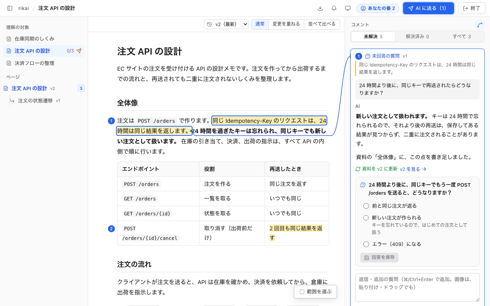
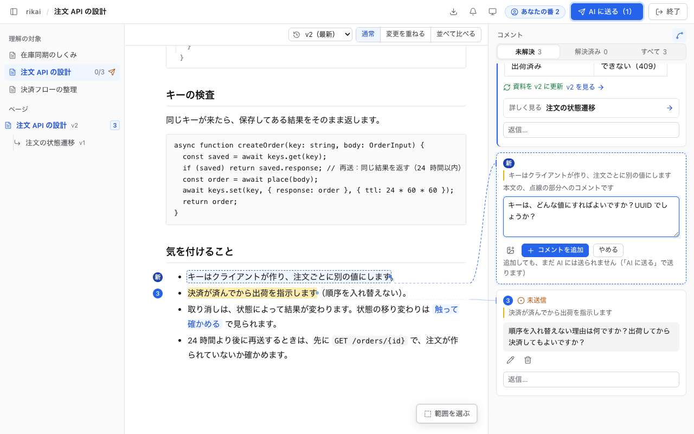
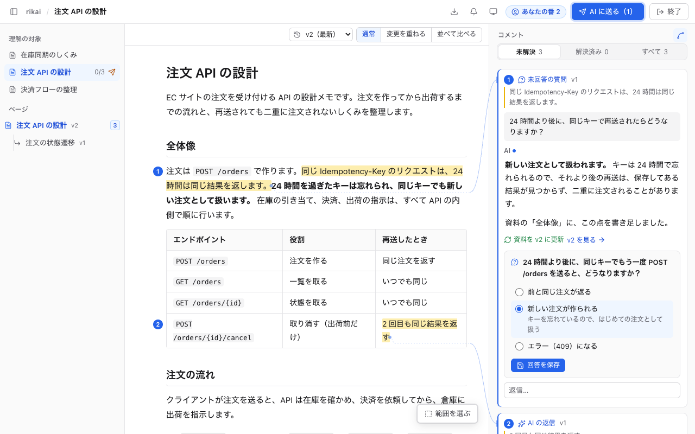
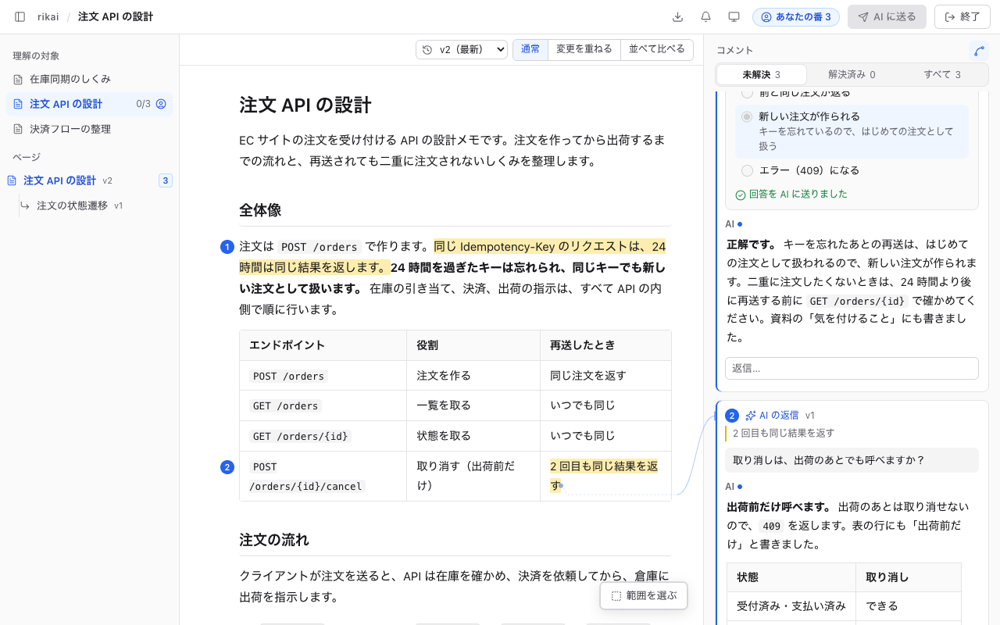
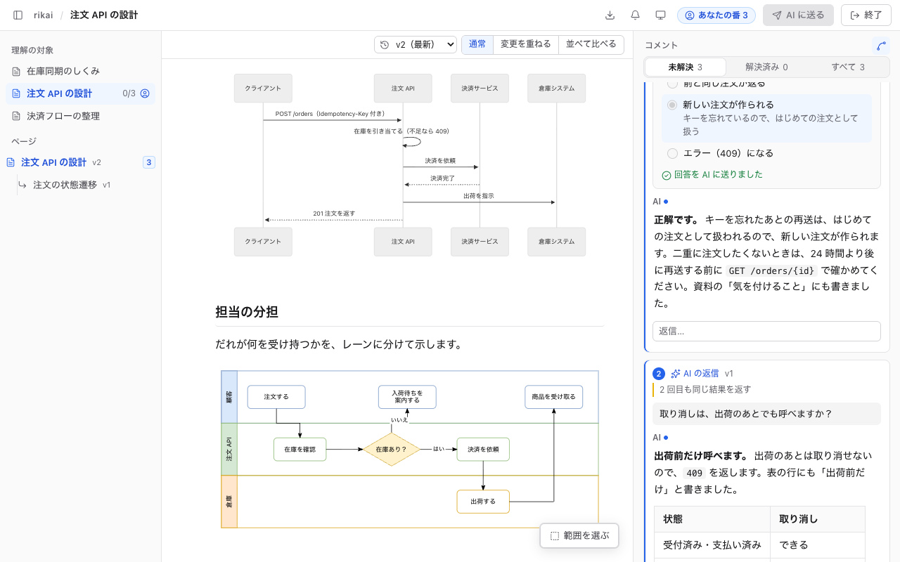
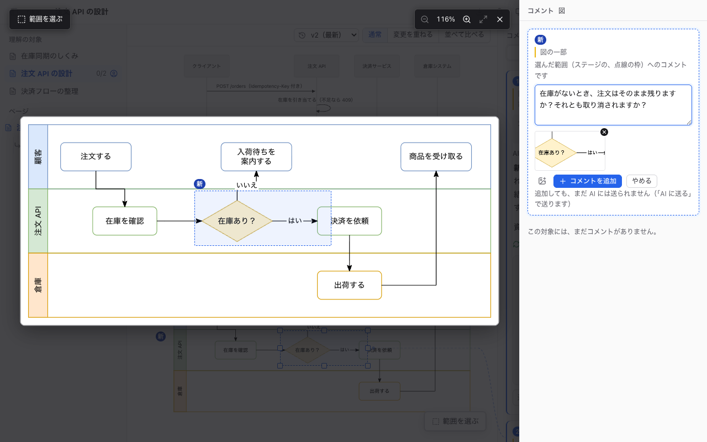
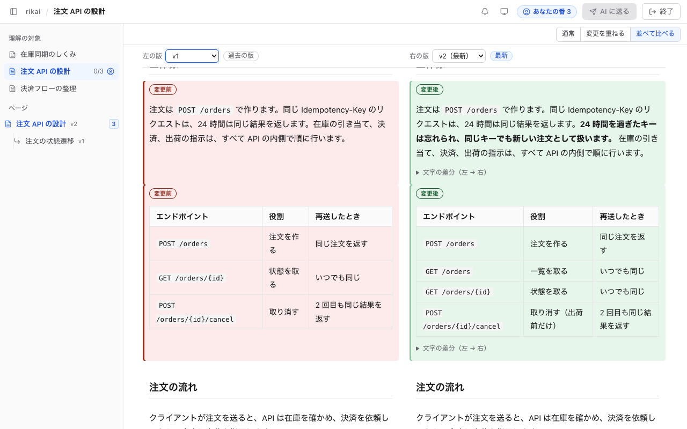
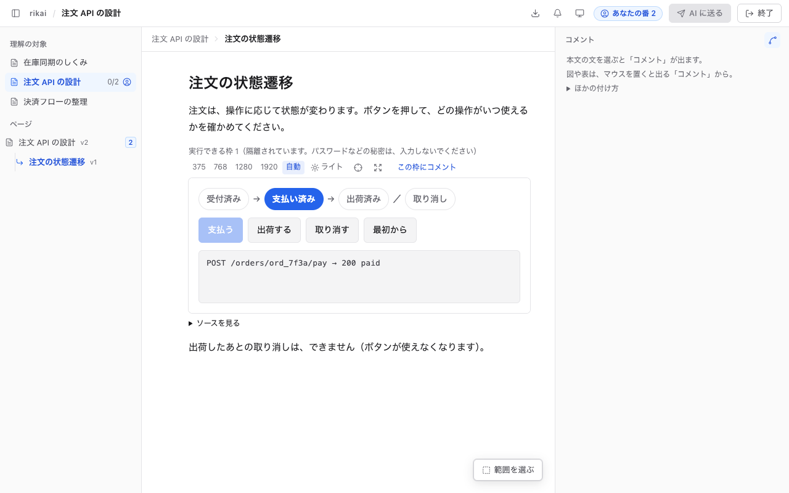
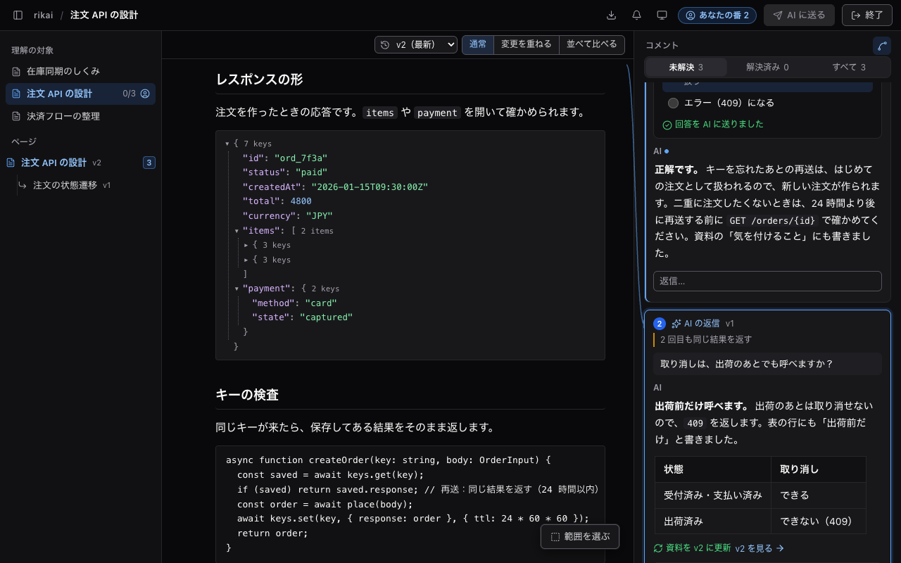
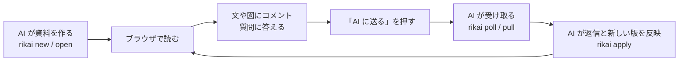

# rikai

[](LICENSE)

資料にコメントして「AI に送る」を押すと、AI が **返信** と **資料の修正（新しい版）** で答えるスキル（`/rikai`）です。AI が書いた説明・PR・設計・コード解説を、ブラウザで読み、コメントし、AI とやりとりしながら、理解できるまで繰り返します。

**試作**です（実装の状態は [docs/status.md](docs/status.md)。実際の Claude Code での通しは、まだ確かめていません）。



（画面の内容は、作り物の資料「注文 API の設計」です。）

## 目次

- [できること](#できること)
- [やりとりの流れ](#やりとりの流れ)
- [必要なもの](#必要なもの)
- [インストール](#インストール)
- [使い方](#使い方)
- [コマンド](#コマンド)
- [保存の形](#保存の形)
- [安全のために](#安全のために)
- [まだないもの](#まだないもの)
- [開発する人へ](#開発する人へ)
- [参考にしたもの](#参考にしたもの)
- [ライセンス](#ライセンス)

## できること

### 文や図にコメントする



- 文や図・表を選んでコメントを付けます（Google ドキュメントのように）。コメントには番号が付き、本文の印と右のカードが対応します（マウスを置くと、お互いに光ります。入力中の対象は、本文で青の破線になります）。
- 右のコメントのカードと、本文の対象は、**線で結ばれます**（右のパネルの見出し「コメント」の右端のボタン「関連の線を出す」で、出し入れできます。既定はオン）。
- 本文の**好きな範囲を選んで**コメントできます（本文の右下に浮かぶ「範囲を選ぶ」ボタン→ドラッグ。文・表・コード・図・画像・複数のブロックにまたがってもよい）。選んだ範囲の画像と位置が、コメントの対象になります。
- コメントと返信には、**画像**を付けられます（貼り付け・ドラッグ・ファイル選択。OS のスクリーンショットも）。AI には、画像のファイルの場所が届きます。

### AI の質問に答える・返信を読む



AI は、理解を確かめる質問を返せます。選択肢・複数選択・Yes/No・5段階・自由記述に答えて「回答を保存」し、まとめて「AI に送る」で送ります。



- 返信は Markdown です（Mermaid・draw.io、表、コード、画像）。返信から子ページ（詳細資料）を作れ、「詳しく見る」で移れます。
- 会話が長くなっても、スレッドのカードでは、**最新のやり取りが見える**ように、古いやり取りを「これまでのやり取り」に折りたたみます（押すと開きます）。
- 解決したスレッドと答えた質問の数で、理解の進み具合が見られます（数だけで、理解できたかの判定ではありません）。
- 上のバーの**ベル**で、**ブラウザの通知**をオンにできます（既定はオフ。押すと、ブラウザが許可を求めます）。画面を見ていないときに、AI の返信・質問・資料の新しい版が届くと、OS の通知で知らせます（トピック名と件数だけ。本文は載せません）。**ほかのトピックの新着も、通知されます**（押すと、そのトピックが開きます）。外への通信は増えません（Web Push は使いません）。

### 図・表・コードを資料に書く



- 資料には、見出し・表・コードに加えて、Mermaid の図と、` ```drawio ` コードブロックで **draw.io の図**（業務フロー・スイムレーン・シーケンス図など）を書けます（XML を、ブラウザの中で SVG に描きます。スクリプトは動かさず、外部の資源も読みません）。
- コードブロックの種類で、**差分（diff）・折りたためる JSON・端末の出力（色つき）・トレース（タイムライン）**を書けます（読めないときは、ふつうのコードブロック）。

### 拡大して見る・範囲を選んでコメントする



- **本文の画像と図**（Mermaid・draw.io・インラインの SVG）と、**`html-app` の枠**は、**拡大表示**で、画面いっぱいに大きく見られます（画像・図は、ホイール・ドラッグ・ダブルクリック・＋／−／0 のキー。Esc で閉じる。ブロックの上のバーの「拡大表示」・キーボードの Enter／Space・`html-app` は見出しの「拡大表示」から開きます。**コメントに添付した画像を押したときも、同じ拡大表示で開きます**：見るだけで、右のドックや範囲を選ぶ道具は出ません）。
- **拡大表示を開いたまま、右のドックで、コメントを書けます**（書きかけの下書きは、閉じても残り、パネルの「AI に送る」で送れます）。
- **画像・図は、細かいところを範囲選択してコメントでき**（元の解像度で切り出されます）、**`html-app` の枠は、範囲選択に加えて、要素を選んでコメントできます**。既存の範囲コメントの枠と番号も、重ねて出ます。

### 版を残し、差分や左右の比較で見る・Markdown を保存する



- 資料は版（v1, v2…）で残ります。過去の版も見られます。版が 2 つ以上あれば、上のバーの**「変更の見せ方」**（**通常｜変更を重ねる｜並べて比べる**）で、前の版からの変更箇所を本文に重ねて表示したり、2 つの版を左右の行に並べて見たりできます（「並べて比べる」は、変更・追加・削除のブロックに、札が付きます。`html-app` の枠も、左右とも動き、幅・外観を左右そろえて変えられます。読み取り専用です：コメントは、最新版の本文（「並べて比べる」を閉じた画面）で付けます）。
- 上のバーの**「Markdown を保存」**で、いま見ているページ・版の本文を、**Markdown のファイル**（`<トピック>-<ページ>-v<版>.md`。root ページはページ名なし）として保存できます（ブラウザの中で保存します。外への通信は増えません）。過去の版・子ページでも使えます。「変更を重ねる」を見ていても、保存するのは**元の Markdown**（差分の装飾なし）で、**コメントは含みません**。画像は `assets/…` の参照のままです（画像のファイルは、`.rikai/<topic>/assets/` にあります）。「並べて比べる」の画面では出ません。

### 触って確かめる部品（html-app）



- 資料に、**JavaScript で動く部品**（```` ```html-app ````）を書けます（スライダー・計算機など、触って理解する資料）。隔離した枠の中で動き、**この画面（コメント・保存）には触れず、外への通信は（WebRTC を除いて）止めています**。枠に、秘密は入力しないでください。
- 枠は、**高さが自動**で、見出しの行のアイコンで、**幅（375・768・1280・1920px。本文より広い幅は縮小して見せます）とライト／ダークを切り替えて見比べられます**（画面のデザイン・UI のレビューにも）。
- 見出しの行から、**「要素を選んでコメント」**（枠の中の要素を押すと、入力欄の上に、**「枠から：要素を選びました」という情報の行**が出ます。開くと、その要素のセレクタ・文字・位置・見た目が読めます。**コメントの本文には書かれません**。「外す」で、この情報だけを外せます。自動では送りません）ができます。枠の中のコードが `rikai.state(obj)` を呼んでいれば、**枠の状態**も、同じ情報の行に入ります。範囲選択で枠が重なるときは、**枠自身が作った画像**が付きます（できなければ、枠の箱）。
- 枠から来た値は、画面とサーバーの両方で検査して、文字・画像のデータとして扱います。AI には、`rikai poll` の出力の `frameMeta` として、**コメントの文（`text`）とは別の項目**で渡り、指示としては読まれません。
- 詳細・安全の考え方は [F28](docs/features/html-app.md#f28-資料に実行できる枠-html-app-を書ける) と [html-app の文書](docs/features/html-app.md)。

### ダークモード・画面の整え方



- **外観**は、ライト・ダーク・システム（OS に従う。既定）から選べます（上のバーのアイコンのボタンで、システム → ライト → ダークと切り替わります。選んだ外観は、このブラウザに覚えます）。`html-app` の枠は、中身が画面の配色に対応しているもの（橋の変数 `--color-*` を使う・`<meta name="color-scheme">` を書く）だけ、画面の外観に従います。**従来の資料の枠は、変わらず、常にライトです**（枠の見出しの行のボタンで、枠だけライト／ダークにして見られます）。
- 左の一覧（トピック・ページ）は、上のバーのアイコンのボタンでしまえます。右のコメントの幅は、境目のドラッグ（ダブルクリックで、もとの幅）で変えられます。設定は、このブラウザに覚えます。

### どこに保存されるか

保存先は **プロジェクト直下の `.rikai/<topic>/`** です。理解の対象ごとにフォルダが分かれます。既定では git 管理外（`.rikai/.gitignore` が `*`）です。中身は [保存の形](#保存の形) を見てください。

各機能の要件の本文は、[docs/features/](docs/features/) にあります（[コメント](docs/features/comments.md)・[範囲と要素](docs/features/region-element.md)・[質問・解決・進み具合](docs/features/threads.md)・[資料の書式](docs/features/doc-format.md)・[拡大表示](docs/features/zoom.md)・[版と差分](docs/features/versions.md)・[html-app](docs/features/html-app.md)・[見た目と広さ](docs/features/appearance.md)・[通知](docs/features/turn-notify.md)）。

## やりとりの流れ



理解できたスレッドは「解決」、全部済んだら「終了」で、このループを終えます。

## 必要なもの

- Node.js 22 以上（追加の npm パッケージは不要。サーバー・CLI も、画面〔React・marked・DOMPurify・mermaid ほか〕も、依存を含めて、ビルド済みのものを `skills/rikai/` に同梱している）
- Claude Code・omp・pi・grok・agy・codex・opencode など、スキル（`SKILL.md`）を読めるエージェント

## インストール

どれか 1 つの方法で入れます。入れたあと、エージェントを開き直してください。

### スキルとして置く（どのエージェントでも）

```bash
git clone https://github.com/takemo101/rikai.git
cd rikai
bash install.sh      # ~/.claude/skills/rikai/ にコピーされる
```

`~/.claude/skills/` を読むエージェント（Claude Code、opencode ほか）で使えます。ほかのエージェントは、`skills/rikai/` を、そのエージェントのスキルの置き場（opencode：`~/.config/opencode/skills/` または `.agents/skills/`、pi：`~/.pi/agent/skills/`、grok：`~/.grok/skills/`、agy：`~/.gemini/config/skills/`）にコピーします。アンインストールは、置いたディレクトリを消します。

### プラグインとして入れる

| エージェント | コマンド | 呼び出し |
|---|---|---|
| Claude Code | `claude plugin marketplace add takemo101/rikai` → `claude plugin install rikai@rikai` | `/rikai:rikai` |
| omp | `omp plugin marketplace add takemo101/rikai` → `omp plugin install rikai@rikai` | `/skill:rikai` |
| pi | `pi install git:github.com/takemo101/rikai` | `/skill:rikai` |
| grok | `grok plugin install takemo101/rikai --trust` | `/rikai` |
| agy | clone して `agy plugin install ./rikai` | `/rikai` |
| codex | `codex plugin marketplace add takemo101/rikai` → `codex plugin add rikai@rikai` | （各エージェントの表示に従う） |

プラグインの中身は、どれも同じ `skills/rikai/` です（マニフェストは、`plugin.json`・`.claude-plugin/`・`.agents/plugins/`・`package.json` の `pi`）。**どのコマンドを、実際に動かして確かめたかは、[検証手順と記録](docs/verification.md#プラグイン対応2026-11-21rik-010) を見てください**（実際のエージェントで `/rikai` を通しで使うことは、まだ確かめていません）。

## 使い方

1. エージェントで `/rikai このPRを理解したい` と打ちます（`/rikai` だけなら直前の回答、`/rikai src/auth.ts` ならそのファイル）。呼び出しの名前は、エージェントによって違います（[上の表](#プラグインとして入れる)）。「理解したい」などの発言から、エージェントが自動で使うこともあります（止め方は [判断の記録](docs/decisions/0006-skill-frontmatter.md)）。
2. ブラウザで資料が開きます。
   - 文を選ぶと、その上に出るバーの「コメント」。ブロック（段落・表・コード・図・画像）にマウスを置くと、そのブロックの右上に出るバーの「コメント」から。本文の好きな範囲は、右下に浮かぶ「範囲を選ぶ」ボタンから。
   - AI の質問に答えて「回答を保存」。
3. 右上の **「AI に送る」** で AI に送ります。
4. AI の返信と新しい版が画面に自動で出ます。足りなければ、またコメントして「AI に送る」を押します。
   - 上のバーの「あなたの番」「AI の返信待ち」「未解決 n」「すべて解決」などで、いま誰の番かが分かります（押すと、該当のカードへ移ります）。未送信の数は、「AI に送る」ボタンに出ます。タブのタイトルにも出ます。
5. 理解できたスレッドは「解決」。全部済んだら「終了」。

### AI に届く仕組み

| エージェント | 方法 |
| --- | --- |
| Claude Code | `rikai poll` をバックグラウンドで待機。「AI に送る」で終了し、その出力で AI が再開します |
| それ以外 | 「AI に送る」を押した後に「rikai に送りました」と伝えると、AI が `rikai pull` で読みに行きます（画面にコピーできる文があります） |

### エージェントなしで、画面を試す

エージェントを使わずに、リポジトリを clone しただけで、画面とループを試せます（実際のプロジェクトの `.rikai/` に触れないよう、`--root` に、使い捨てのディレクトリを指定します）。

```bash
git clone https://github.com/takemo101/rikai.git
cd rikai
mkdir -p /tmp/rikai-try
rikai() { node "$PWD/skills/rikai/rikai.js" --root /tmp/rikai-try "$@"; }

rikai new demo --title "試し" <<'MD'
# 試し
作り物の本文です。
MD
rikai open demo --no-open      # url が出る。ブラウザで開く
```

ブラウザで、文を選んでコメントし、「AI に送る」を押します。そのあと、AI の代わりに、手で返信します。

```bash
rikai pull demo                # 届いたコメントが JSON で出る（"thread" の値が、スレッドの ID）
rikai apply demo <<'JSON'
{"replies":[{"thread":"t1","body":"返信です。"}]}
JSON
rikai stop; rm -rf /tmp/rikai-try
```

画面に、返信が出ます。`apply` の入力の形（新しい版・子ページ・質問）は、[SKILL.md](skills/rikai/SKILL.md) にあります。

## コマンド

`rikai` は、PATH にあるコマンドではなく、`skills/rikai/rikai.js` を `node` で動かす呼び方の略です（エージェントが、`rikai() { node "<スキルのディレクトリ>/rikai.js" "$@"; }` のようなシェル関数として定義して使います）。

| コマンド | 内容 |
|---|---|
| `rikai new <topic> --title <題名> [--source <対象>]` | 標準入力の Markdown から、新しいトピックを作る |
| `rikai open <topic> [--no-open]` | ビューアを起動して URL を出す |
| `rikai poll <topic> [--timeout 秒]` | 「AI に送る」が押されるまで待ち、コメントのバッチを出す（Claude Code 向け） |
| `rikai pull <topic>` | 待たずに、未処理のバッチがあれば出す |
| `rikai apply <topic>` | 標準入力の JSON で、返信・新版・子ページ・質問を反映する |
| `rikai status [topic]` | 未処理のバッチなどを見る |
| `rikai stop` | サーバーを止める |

共通の引数は `--root <dir>`（プロジェクトのルート。省略時は git のルート、なければカレントディレクトリ）です。

詳細は `skills/rikai/SKILL.md`（本体）と、必要な場面で読む補助 `skills/rikai/references/`（`html-app.md`・`doc-format.md`・`poll-output.md`・`viewer.md`・`drawio.md`）を見てください。

## 保存の形

```text
<project>/.rikai/
  .gitignore
  <topic>/
    meta.json         題名・ページ木・現在の版
    pages/<page>/v1.md v2.md …
    assets/           画像
    threads.json      コメント・返信・質問・回答
    rounds/001.json   「AI に送る」ごとの送信内容
```

## 安全のために

- サーバーは `127.0.0.1` だけで待ち受けます。起動ごとの合言葉（URL の `?t=`）を Cookie に移し、Host・Origin も確かめます。URL は人に見せないでください。
- AI が書いた Markdown/HTML は DOMPurify で無害化して表示します（`<script>`・`<style>`・iframe・`on*` 属性を除去）。外部の画像は表示しません。Mermaid は `securityLevel: 'strict'` です。
- AI が書いた JavaScript は、**`html-app` の枠の中だけ**で動きます。枠は、別の文書として配られ、`sandbox`（画面の DOM・Cookie・合言葉に触れない）と、外への通信を止める CSP で隔離されます。**止められない通信の抜け道（WebRTC など）が一部あります**ので、枠の中に、パスワードなどの秘密は入力しないでください（[F28](docs/features/html-app.md#f28-資料に実行できる枠-html-app-を書ける)）。枠の中身は、「ソースを見る」で読めます。

## まだないもの

- Markdown のソースどうしの行単位の差分と、ブロックの移動の追跡（版どうしの差分は、表示されたブロックの文字の追加・削除として見せます。移動は、削除と追加に見えます）
- 書き換えられて消えた文へのコメントの自動追従（見つからなければ「修正で文が変わりました」と表示します）
- Windows・Linux・Safari・Firefox での動作確認（macOS の Chromium 系で確認）
- Claude Code 以外のエージェントでの `poll` に近い待ち方、子ページを押したときの生成、チームでの `.rikai/` の共有の補助、`npx`・プラグインでの配布（どれも、[SPEC §7](SPEC.md#7-未決事項) の未決事項）
- 実際の Claude Code から `/rikai` を使った通しの確認（`install.sh` でコピーするところまでは確認済み）

## 開発する人へ

続きの開発は [AGENTS.md](AGENTS.md)（規約）と [docs/README.md](docs/README.md)（文書の案内）から読んでください。製品要件の正本は [SPEC.md](SPEC.md)（索引。機能の要件の本文は [docs/features/](docs/features/)、実装の状態は [docs/status.md](docs/status.md)、利用者の決定と設計の判断は [docs/decisions/](docs/decisions/README.md)）、確認した範囲は [検証手順と記録](docs/verification.md) です。

```bash
pnpm install          # 開発の依存（Node 22.12 以上と pnpm。利用者には要らない）
pnpm test             # 自動テスト（Vitest。サーバー・CLI・画面〔jsdom〕・配布物が古くないこと）
pnpm run test:e2e     # 実際の Chrome での確認（Playwright。先に pnpm run build。Chrome は、環境変数 RIKAI_CHROME に、実行ファイルを指定。なければ、一般的な場所から探し、なければ skip）
pnpm run build        # サーバー・CLI・画面を skills/rikai/ にビルドする（コミットする）
pnpm --dir app dev    # 画面の開発サーバー（RIKAI_SERVER が要る。docs/development.md）
```

## 参考にしたもの

[understand-mode](https://github.com/fkubota/understand-mode)（ローカルサーバー + ブラウザ + スキル）、[human-review](https://github.com/petergyang/human-review)（選択範囲へのコメントと Submit、poll による待機）、[sideshow](https://github.com/modem-dev/sideshow)（対象ごとのスレッドと版）。

## ライセンス

MIT（[LICENSE](LICENSE)）。同梱しているライブラリは、サーバー・CLI の依存が `skills/rikai/THIRD-PARTY-LICENSES.txt`、画面の依存が `skills/rikai/public/THIRD-PARTY-LICENSES.txt` を参照してください。
