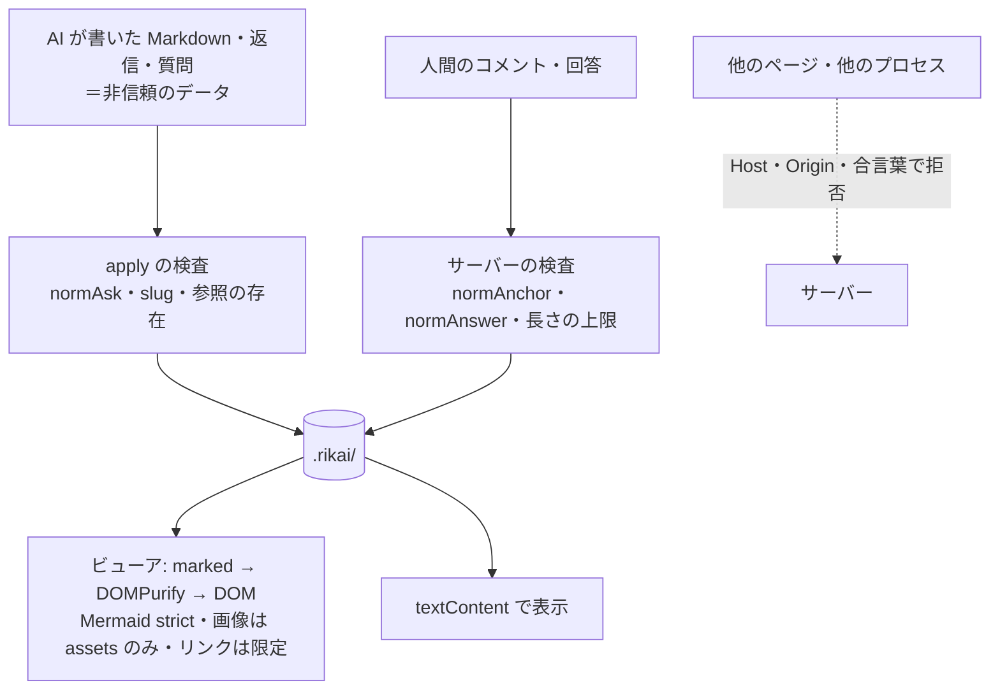

# 構成説明

ファイルの責務・状態の所有・時間と並行・失敗の扱い・信頼の境界。製品要件の正本は [SPEC](../SPEC.md)、設計原則の選択は [参考にした設計原則](references.md)、書き方は [コーディング指針](coding-guidelines.md)。**ここは構造と理由を説明する文書**で、確定 API・動作の保証・検証の結果（[検証手順と記録](verification.md)）は書かない。

## 全体

```mermaid
flowchart LR
    subgraph Agent[エージェント（Claude Code など）]
        SK[SKILL.md<br/>手順を読む]
        CLI[rikai new / open / poll / pull / apply / status]
    end
    subgraph Local[この Mac（127.0.0.1）]
        SV[rikai.js serve<br/>ローカルサーバー]
        FS[(.rikai/&lt;topic&gt;/<br/>meta・threads・pages・rounds・assets)]
        subgraph Browser[ブラウザ]
            APP[画面（React）<br/>app/src/web]
        end
    end
    SK --> CLI
    CLI -->|読み書き| FS
    CLI -->|起動・疎通| SV
    SV -->|読み書き| FS
    APP <-->|HTTP + Cookie| SV
    SV -.SSE：変わったという通知だけ.-> APP
    APP -.通知で、差分を取る（切れている間だけ、1.5秒ごと）.-> SV
```

流れは、次の 4 つ。**エージェントとサーバーは、互いに通信せず、`.rikai/` のファイルを介して渡し合う**（`poll` は、round のファイルを見に行く）。

1. **作る**：エージェントが `rikai new`（Markdown を標準入力）→ `rikai open`（サーバーの起動・URL）。
2. **コメントする**：人間がビューアで、コメント・回答を書く（サーバーが `threads.json` に下書きとして保存）→ Submit（`rounds/NNN.json` ができる）。
3. **読む**：エージェントの `rikai poll`（または `pull`）が、`pending` の round を出す。
4. **答える**：エージェントが `rikai apply`（返信・新版・子ページ・質問を 1 回で反映）。ビューアが、次の確認で、変更を取り込んで描き直す。

## ファイルの責務

| 場所 | 責務 | 持たないもの |
| --- | --- | --- |
| `app/src/cli/main.ts`（バンドル：`skills/rikai/rikai.js`）・`app/src/cli/stdin.ts` | **CLI の入口**：各コマンド（`new`・`open`・`poll`・`pull`・`apply`・`status`・`stop`・内部の `serve`）の振り分け（`poll`・`pull`・`apply`・`status` の中身は、`server/agent.ts` の `createAgent`）。**起動まわり**（サーバーの起動・疎通〔`ensureServer`〕・ブラウザを開く・`serve` の終了処理〔`hooks.allClosed` へ `shutdown`〕の取りつけ）・`HELP`。**標準入力は、`cli/stdin.ts` の `readStdin(input = process.stdin)`（非同期）で読む**：`for await` で、**バイトのまま集めて**（`Buffer.concat`）、**1 度だけ** UTF-8 にする（チャンクの境目で、日本語・絵文字が割れない）。`fs.readFileSync(0)` は使わない：パイプ・ヒアドキュメントがノンブロッキングのとき、約 18 万バイト以上で `EAGAIN` で失敗した（0.25.0 で修正。`new`・`apply` は `await` する）。**標準入力が端末（TTY）のときは、待たずに、400「標準入力で渡してください」で失敗する**。`stdin.ts` は、**副作用がなく、読み込んでも動かない**（0.25.1 で、`main.ts` から切り出した：`main.ts` は読み込むと動き出すので、TTY の確認を、単体で試験できなかった。偽の TTY ストリームを渡して試験する：`test/server/cli-stdin-unit.test.ts`。バンドルを子プロセスで動かす試験：`test/server/cli-stdin.test.ts`）。**読み込むと動き出す**（`main.ts` の末尾の `main()`）ので、テストは `main.ts` を読み込まず、バンドルを子プロセスで動かす（`app/test/setup/cli.ts`） | 画面の描画・資料の中身の解釈・データの検査（`server/` の仕事） |
| `app/src/cli/args.ts` | **引数の解釈**：`parseArgs`・`projectRoot`。副作用がない | コマンドの実行 |
| `app/src/server/util.ts` | 共通の小さな道具：`HttpError`・`out`・`now`・`readJSON`・`writeJSON`・`sleep`・`sleepSync`・入力の整形（`str`・`normAnchor`・`normRect`）。`server/` のほかのモジュールに依存しない（型の `shared/types` だけ） | |
| `app/src/server/store.ts` | **ストア**：`createStore(root)` が返す `Store`（`.rikai/<topic>/` の読み書き・ロック〔`withLock`〕・`mutate`・`loadMeta`／`loadThreads`・トピックの一覧・`newTopic`・**`summaryOrNull`**・`updatedAt`）と、データの形の版（`SCHEMA`・`isSupported`）・`checkSlug`。**`summaryOrNull(meta, 窓)`**（F46）：一覧に付ける、トピックごとの要約 `TopicSummary`（`progress` と `fresh`）を、`threads.json` の **1 回の走査**で作り、結果を、**`rev`・更新時刻・大きさ・窓**をキーに、覚える（変更のないトピックは読み直さない。手で書き換えたファイルも検出する。窓が違えば、別の結果。読めない `threads.json` は `null`：警告は、トピックごとに 1 回）。**プロジェクトのルートは、`createStore` の引数で持つ**（モジュールの変数を持たない。旧実装は、モジュールの変数 `ROOT`・`BASE`） | HTTP・画面の操作・AI 向けの検査 |
| `app/src/server/ask.ts` | **ask の検査**：`normAsk`（AI が出す質問）・`normAnswer`（人の回答） | ファイルの読み書き |
| `app/src/server/actions.ts` | **画面からの操作**（`createActions(store, hooks)` が返す `Actions`：`comment`・`reply`・`answer`・`edit`・`delete`・`resolve`・`submit`・`end`・`attach`）。全トピックが閉じたときの動き `hooks.allClosed`（既定は何もしない。`serve` のプロセスが、`createActions` の引数で、終了の処理を入れる） | HTTP |
| `app/src/server/agent.ts` | **AI 向けの操作**：`createAgent(store)` が返す `Agent`（`listRounds`・`peek`〔`poll`・`pull` が共有〕・`cmdPoll`・`cmdPull`・`cmdApply`〔検証してから書く〕・`cmdStatus`。出力するコマンドは、`out` で JSON を出す） | HTTP・画面の操作 |
| `app/src/server/app.ts` | **HTTP アプリ（Hono）**：`createApp({ store, token, port, publicDir, actions, feed? })`。認証（合言葉・`Host`・`Origin`）・配信・ルーティング・本体の検査（`shared/api.ts` の zod）。**ストア・合言葉・ポート・操作・変更の通知の元（`feed`）は、引数で渡す**（モジュールの状態を持たない）。`GET /api/events`（SSE）の購読・ping・接続数の上限もここ。ポートを開かず、`app.request()` で試せる | データの検査（`actions` と `store` を呼ぶだけ）・待ち受け |
| `app/src/server/watch.ts` | **変更の通知の元**：`createChangeFeed(store, opts)`（購読者が 1 人以上いる間だけ、`.rikai/` を `fs.watch`〔再帰〕と、約 300ms ごとの確認〔stat の印が変わったトピックの `meta.json` の `rev` を読む〕で見張る。別のプロセス〔`rikai apply`〕の書き込みは、ここで知る）。新しいトピック・消えたトピックは `{topics:true}`、`rev` が変わったトピックは `{slug,rev}` を、購読者へ渡す（同じ `rev` は二重に送らない・続けた変化は 30ms でまとめる）。0 人になれば、ウォッチャー・タイマーを解く。状態は `createChangeFeed` ごと（グローバルを持たない） | データの読み書き・HTTP |
| `app/src/server/serve.ts` | **待ち受け**：`startServer(store, hooks, publicDir, feed)`（127.0.0.1 の空きポート・起動のたびに合言葉を作り、`createApp` を Node の HTTP サーバーに載せる）・`shutdown`（`.server.json` が自分のものなら消して、プロセスを終える。SSE の接続も、終了で閉じる） | 経路・認証（`app.ts` の仕事） |
| `app/src/server/image.ts` | **添付の画像の検査**：形式を中身の先頭のバイトで見分ける（`decodeImage`。png・jpeg・gif・webp だけ。5MB まで）・名前を、中身のハッシュから決める（`c-<16 文字>.<拡張子>`）・名前の形（`IMG_NAME_RE`）・枚数の上限。保存・参照の検査は `actions.ts`（`attach`・`normImages`） | ファイルの読み書き・HTTP |
| `app/src/server/htmlapp-core.ts`・`htmlapp.ts`・`htmlapp-worker.ts`・`appframe.ts`・`appframe-bridge.ts` | **実行できる枠（`html-app`）の、中身の取り出し**：資料（Markdown）の ```` ```html-app ```` フェンスを、marked の字句解析で、文書の順に取り出す。`htmlapp-core.ts`：`appsOf`・`kindOf`（純粋）。`htmlapp.ts`：`appsOfAsync`（別のスレッドで、3 秒で切る・上限 `APP_MAX`・`DOC_MAX`・`AppsError`）。`htmlapp-worker.ts`：worker の入口（バンドルが、別のファイル `rikai-htmlapp-worker.js` にする）。`appframe.ts`：`createAppFrames(store)` の `appsOfPage`（版ごとの結果・失敗・進行中の解析の覚え。状態は `createAppFrames` ごと）。**`appframe-bridge.ts`（F40）**：枠の文書を作る純粋関数（`frameDocument(content, mode)`・`parseMode`〔`?mode=` は、`light` か `dark` がちょうど 1 つのときだけ有効〕）と、**橋のスクリプト**（`BRIDGE_SOURCE`。`100vh` の止め方：超える分が 64px 以下で、報告する高さが 2400px 以下のときだけ `overflow-y: hidden`、それ以外は `auto`）・**土台のスタイル**（`BASE_STYLE`。すべて `:where()`。`:root` の色の宣言は `BRIDGE_COLORS` から作る）。**土台とダークへの追従は、オプトイン**：`shared/htmlapp-theme.ts` の `followsTheme(content)`（サーバーと画面で同じ関数）が true の枠だけ（`<html data-follow data-theme>`・土台のスタイル）。**true の条件**：橋が配る色（`BRIDGE_COLORS`：`bg`・`surface`・`ink`・`ink-2`・`muted`・`line`・`accent`・`accent-ink`・`accent-fill`・`ok`・`warn`・`err`）の `var(--color-<名前>` を使い、かつ、同じ名前を自分では定義していない／`<meta name="color-scheme">` がある。`--color-primary` など、橋が配らない名前・`data-theme` の文字は、印にしない（自作の `--color-*` を書いた従来の資料を、壊さないため）。**false の枠（従来の資料）の文書は、`<!doctype html>`・`<meta charset>`・橋の `<script>`・中身だけ**（従来との差分は、橋の `<script>` だけ）。**何も実行しない**。配るのは `app.ts` の `/appframe`（`APP_CSP`：`sandbox allow-scripts` ほか。**橋を足しても、`APP_CSP` は変えない**）。marked は、npm の版をバンドルしている。ブラウザ側は、`web/doc/render/markdown.ts` が、フェンスを枠の置き場（`div.htmlapp`）にし、`web/doc/render/apps.ts` の `fillApps` が、`sandbox="allow-scripts"` の iframe を入れる | ファイルの読み書き（`appframe.ts` の読み出しを除く）・HTTP・枠の中身の実行 |
| `app/src/shared/anchor.ts`・`diff.ts`・`progress.ts`・`fresh.ts` | サーバーと画面が共有する、**DOM に触れない純粋な関数**。`anchor.ts`：`findQuote`・`locateBlock`・`similarity`（コメントの探し直し。画面は `web/doc/render/highlights.ts` が使う）。`diff.ts`：`diffText`・`matchBlocks`（版どうしの差分。`anchor.ts` の `similarity` を使う。画面は `web/doc/render/diff.ts`〔F11〕と `web/doc/render/compare.ts`〔F44〕が使う。**戻り値の `limited`**：近さを調べる組の予算〔`MAX_PAIRS`〕を超えて、一部の区間で、近さによる対応づけをしなかった：比べる画面が、案内を出す）。`progress.ts`：`progressOf`（理解の進み具合の数。**数だけ**。サーバーは `store.ts`・`agent.ts`、画面は左の一覧が使う）。**`fresh.ts`**（F46）：**AI の新着を決める、ID の集合**。`freshOf(threads, pages, max)`〔`replies`・`asks`・`openAsks`・`versions`・`window?`。`max` は各項目の上限〔窓〕：新しい側〔ID の連番が大きい側〕から。`openAsks` は、切ったあとの `asks` の部分集合。上限なしで作った `fresh` には `window` が付かない〕・**`freshWindow(N)`**〔`clamp(floor(FRESH_TOTAL_MAX / N), FRESH_MIN, FRESH_MAX)`：通知の対象のトピックの数 N で、窓を割る〕・`FRESH_MAX`〔200〕・`FRESH_MIN`〔20〕・`FRESH_TOTAL_MAX`〔4000〕・`FRESH_TOPICS_MAX`〔= `FRESH_TOTAL_MAX / FRESH_MIN` = 200。対象がこれを超えるときだけ、更新が新しい順に、この数のトピックに付ける〕・`freshSize`・**`answerOf`・`askStale`・`awaitsAnswer`**（質問が、まだ答えを求められているかの判定：**1 か所**。画面の F39 の判定〔`lib/turn.ts`・`panel/logic.ts`〕と、サーバーの `fresh` が、同じ関数を使う）。サーバー〔`summaryOrNull`〕は `freshOf(…, 窓)`・画面の、開いているトピックの `snapshotOf` は `freshOf(…, 上限なし)` | DOM・ネットワーク |
| `app/src/shared/types.ts`・`api.ts` | 共有の型（`Thread`・`Meta`・`Round`・`Ask` ほか）・画面からの操作の本体の zod のスキーマ（`apiBodies`） | ロジック |
| `app/scripts/build.ts`・`app/vite.config.ts` | **ビルド**（`pnpm run build` = `build:server` + `build:web`）：`build.ts`（`build:server`）が、`app/src/cli/main.ts` と `htmlapp-worker.ts` を、**依存を含めて 1 ファイルずつ**にバンドルして（esbuild・CJS・Node 22）、`skills/rikai/rikai.js`・`rikai-htmlapp-worker.js` に置き、バンドルに入った依存の `THIRD-PARTY-LICENSES.txt` を生成する。`vite.config.ts`（`build:web`）が、画面（`app/src/web/`）を、`skills/rikai/public/` にバンドルする（ライセンス表は、`scripts/licenses-plugin.ts`）。**生成物は、コミットする**（`app/test/build.test.ts` が、ソースと違うと落ちる） | 実行時のロジック |
| `skills/rikai/rikai.js`・`rikai-htmlapp-worker.js`・`THIRD-PARTY-LICENSES.txt` | **サーバー・CLI の配布物（生成物。手で編集しない）**：上のビルドの出力。利用者の環境に、`npm install` は要らない（SPEC N5） | |
| `app/src/web/`（`main.tsx`・`App.tsx`・`contracts.ts`） | **画面（React 19・Vite・TypeScript strict）**：`main.tsx` が `App` を `QueryClientProvider` の下に置く。`App.tsx` が、ルート（`lib/route.ts`）とトピックから決まる「いまのページ・版」（`lib/view.ts`）を、各部品へ渡して、つなぐ。`contracts.ts`：本文・右のパネル・入口のバーが、公開する部品の props の型と、旧 UI から引き継いだ DOM の ID（`#app`・`#top`・`#side`・`#doc`・`#article`・`#badges`・`#threads`・`#actbar` ほか。`styles/app.css` と e2e が使う） | データの正本（サーバーが持つ。ここは写しと下書き） |
| `app/src/web/api/` | **サーバーとの通信**：`client.ts`（Hono RPC の型つきクライアント `hc<AppType>`。型は、`server/app.ts` の `AppType` から）・`events.ts`（`useServerEvents`：`App` が 1 回だけ持つ。通知は、SharedWorker〔`eventsWorker.ts`〕のメッセージで受ける。`ready`・`changed` で、既存の取得をすぐ実行し〔`invalidateQueries`〕、つながっている間は `ui.live` でポーリングを止める。切れたら、ポーリングに戻る。つながっていたものが切れた 1 回だけ、すぐ取り直す）・`eventsWorker.ts`（**SharedWorker**：`EventSource('/api/events')` を、**ブラウザ全体で 1 本**だけ持ち、つながっている全部のタブ〔ポート〕へ、`ready`・`changed`・`error` を配る。新しいポートには、いまの状態を、すぐ返す。`bye` でポートを解き、0 になったら閉じる。画面のコードを import しない。Vite が、別のファイルにバンドルする）・`queries.ts`（読み取り：トピックの一覧・トピックの状態〔`?since=<rev>`〕は、通知〔SSE〕が切れている間だけ 1.5 秒ごとのポーリング・ページの本文）・`mutations.ts`（操作：成功したら、トピックをすぐ取り直す。失敗はトーストで知らせる）・`queryClient.ts`。**サーバーの状態は、TanStack Query だけが持つ** | 画面の状態・描画 |
| `app/src/web/store/` | **ブラウザの状態（Zustand）**：`ui.ts`（UI の状態：入力欄・選んでいるスレッド・下書き・既読・パネルの切り替え・左の一覧の開閉と右の幅・**外観のモード `theme`**・トースト。書き込みは、ここの関数だけ）・`doc.ts`（`DocModel`：本文を描いたあとの、どのブロック・強調・番号がどこにあるか。**書くのは `doc/Article.tsx` だけ**。ほかは読む） | サーバーの状態（`api/`） |
| `app/src/web/doc/`・`doc/render/` | **本文（命令的な「島」）**：`Article.tsx` は、子を持たない要素で、中身を `renderDoc.ts` が作って差し替える（React は中身に触れない）。順番：`markdown.ts`（Markdown → DOMPurify〔`PURIFY`〕→ リンク・画像の限定。本文と AI の返信は同じ `mdToFragment`。返信は `kind: 'reply'`）→ `blocks.ts`（ブロックの番号・ハッシュ・本文の文字の数え方）→（v2 以降）`diff.ts`（差分の印）→ 形式（`fmt.ts`：diff・json・terminal・trace。文字は必ず escape）・`apps.ts`（`html-app` の iframe）・`mermaid.ts`（動的 import。図のない資料では読まない）→ `highlights.ts`（コメントの位置づけと強調）。`hit.ts`：マウスが指すコメント。**画像・図の拡大**（F37）：`zoomOpen.ts` が、既存の click 委譲（`Article.tsx`・`ThreadsPanel`）から、押された `img`・Mermaid の図・インラインの `<svg>` を見つけ、ライトボックスを開く（本文の DOM には、何も足さない・動かさない。開かない条件：文字の選択・4px を超えたドラッグ・修飾キー・右ボタンほか）。コメントの付いたものは、従来どおり、コメントを選ぶ（拡大は、入口のバーの「拡大」から） | サーバーとの通信・ブラウザの状態の書き込み（`DocModel` を除く） |
| `app/src/web/overlay/` | **番号の層**（`#badges`）：番号の丸と範囲の枠を、本文の外の層に、測定してから置く（`place.ts`。位置の計算は `layout.ts`）。**同じ行の丸**（F35 の (6)）は、折り返さず、右詰めで、2px ずつ重ねて並べる（幅は、文字数で決め、`width` で固定：`badgeWidth`・`stackWidth`）。**左の見える幅に収まる数だけ**並べ、6 件以上は先頭 4 つと「+N」にまとめる（`foldBadges`）。「+N」のホバーで、まとめた丸が、ポップオーバー（`.bno-pop`）に、実際の大きさで開く（「+N」の真下。下に入りきらなければ、上〔`.up`〕）。入力中の範囲の枠の調整（`regionAdjust.ts`。F31）。**関連の線**（`Connectors.tsx`・`connectorPath.ts`。F35）：右のカードと本文の対象を結ぶ、画面に固定の `<svg id="links">`（押せない・図形だけ）。端点は、いま右のパネルに出ているカードの DOM と、DocModel の位置から、実測で決める（読みを先にまとめ、`requestAnimationFrame` で 1 フレーム 1 回。見える範囲の外は縁へ寄せる）。**すべての線は、同じ x（記事の右端 +6px）まで水平に引き出してから S 字に入る**（引き出しの高さは、強調の矩形の下端 + 2px。引き出しの部分は、別の線〔`.cn-lead`〕で、薄い点線）。**同じ行は、カードの高さの順に、行間の中で 2px ずつ始点をずらす**（実際に引く線だけで決める。同じ行も、隣の行も、交差しない。`connectorPath.ts`）。表示のオン・オフは `ui.links`（`rikai-ui`） | 本文の中への書き込み |
| `app/src/web/panel/` | **右のパネル**（`#threads`）：スレッドのカード・メッセージ・入力欄・ask の入力（5 つの型。`AskView.tsx`）・画像の添付・拡大表示。判定は `logic.ts`（純粋）。カードは、キーで同じ DOM を使い回す | 本文の描画 |
| `app/src/web/interact/` | **本文への入口**：文の選択 → アンカー（`selection.ts`）・入口のバー（`ActionBar.tsx`）・範囲選択（`RegionSelect.tsx`・`region.ts`：範囲の画像を切り出す。**`html-app` の枠〔別オリジンの隔離した iframe〕は、複製に中身が入らないので、複製から外し、同じ位置・大きさ〔縮小表示の `transform` も含む〕の「枠の箱」を、複製の外に置く**：`FRAME_PLACEHOLDER_TEXT`・`framePlaceholder`。枠の中は、親から読まない）・本文と右のカードのお互いの光り（`hoverLink.ts`） | カードの描画 |
| `app/src/web/layout/`・`lib/` | **枠組み**：上のバー（外観のボタン `#btn-theme`）・左の一覧・ドキュメントバー・右の幅の取っ手・ダイアログ（Submit・終了）・トースト・終わりの画面（`layout/`）。ルート（ハッシュ）・いまの版・localStorage（`rikai-seen`・`rikai-ui`）・DOM の小道具・**外観の解決**（`lib/theme.ts`：`parseTheme`・`nextTheme`・`applyTheme`〔`<html data-theme>` を付け外し〕・`resolvedTheme`〔「いま、ライトか、ダークか」を 1 か所で決める〕・`subscribeResolved`・`useResolvedTheme`。Mermaid が使う）・**拡大の計算**（`lib/zoom.ts`：ズーム・移動・全体表示の、純粋関数）・**SVG の複製**（`lib/zoomSvg.ts`：`cloneNode(true)` した SVG の `id` に接頭辞 `zoom-` を付け、`url(#…)`・`href="#…"`・`aria-labelledby`・`<style>` の `#id` 選択子も書き換える）（`lib/`）。**ライトボックス**（`panel/Lightbox.tsx`。`#lightbox`）：`ui.lightbox` は、`{kind:'img', src, alt, zoom}`（添付の画像は `zoom:false`＝押すと閉じる）か `{kind:'svg', node, alt, size}`。**ちらつき（FOUC）の対策**：`app/src/web/public/assets/theme-init.js`（同期・外部ファイル）が、`<head>` の CSS より前に、保存した外観を `data-theme` に付ける（CSP が `script-src 'self'` で、インラインのスクリプトは使えないが、外部ファイルは許される。規則は `parseTheme` と同じ）。`main.tsx` の `applyTheme` も、残す | |
| `app/src/web/styles/` | **見た目**：`app.css`（画面の CSS。先頭の `:root` に、色・角丸・影・文字の大きさのトークン。**色は、`color-scheme` と `light-dark(ライト, ダーク)` で、トークンに、1 か所で持つ**〔`:root { color-scheme: light dark }`・`data-theme="light"`／`"dark"` で固定・system は属性なし〕。アクセントは青 1 色、状態の色〔未送信＝琥珀・解決＝緑〕は文字・アイコンだけ。**白文字を載せる塗りは、塗り用のトークン**〔`--done-fill` など。文字用の色を塗りに使わない〕。ダークの `#actbar`・トーストは、縁〔`--tip-edge`〕。クラス名は、e2e と旧 UI から引き継ぐ）・`connectors.css`（関連の線）。**画面の見た目は、この 2 つだけ**（CSS フレームワークは使わない：Tailwind は 2026-11-24 に外した）。アイコンは `lucide-react`（インライン SVG。使うものだけがバンドルに入り、ライセンスは `THIRD-PARTY-LICENSES.txt` に出る）。**Mermaid の図**（`doc/render/mermaid.ts`）は、CSS で色が変わらないので、ライトは `neutral`・ダークは `dark`（ダークのときだけ `themeVariables`）で描く。**描画は、1 本の Promise の連鎖**で、毎回 `initialize(外観)` してから `render` し、**描き終えた時点で外観が違えば、キャッシュにも画面にも入れず捨てる**（`mermaid.initialize` がグローバルなので）。**図のキャッシュのキーに外観を含める**（外観が変わったら、本文と返信の図を描き直す）。**`html-app` の枠**：画面の配色への対応を示した枠だけ（`followsTheme`。F40）が、画面の外観に従う（別の文書で、橋が外観〔`theme`〕を送る）。**示していない枠（従来の資料）は、従来どおり、常にライト**（`.appframe { color-scheme: light }`。地は、ライトは白・ダークは黒〔`iframe[data-mode]`〕）。枠の中の色は、AI の CSS と、`:where()` の土台が決める。表示の幅の縮小は、ラッパー `.appview`（`transform: scale`）・ツールバーは `.apptools`（`flex-wrap: wrap`） | ロジック |
| `app/src/web/lib/turn.ts`・`layout/TurnPill.tsx` | **「いま、誰の番か」**（F39）：`lib/turn.ts` が、トピックの状態を、**1 か所の純粋関数**で決める（`turnOfTopic`〔開いているトピック。スレッドの中身まで〕・要約だけで決める版〔他のトピック〕・`openAsksOf`・`unseenRepliesOf`。DOM・ストアに触れない。**質問の判定 `awaitsAnswer` は、0.27.0 から `shared/fresh.ts`**）。優先順：closed → unsent → waiting-ai → empty → your-turn〔AI の新着返信か未回答の質問〕→ open〔未解決だけ。灰色の「未解決 n」〕→ done。見える数字・タイトルの `(n)` は、`Turn.mine`（あなたの番のスレッドの数）。**`TurnPill`（上のバーの `#turn`。読み上げ用の `.turn-sr` は、件数を含まない状態名だけ）・左の一覧の印（アイコンだけ。「待ち」は文字つき）・カードの札（`panel/ThreadCard.tsx`・`panel/logic.ts`）・タブのタイトル（`App.tsx` の 1 か所。題は `lib/dom.ts` の `trunc` で、コードポイント単位に切る）が、同じ判定を使う**。サーバー・CLI・HTTP・データの形式は、変えない（画面が持つデータだけ。AI が `poll` で待っているかは、サーバーから分からないので使わない）。押すと、新着返信 → 未回答の質問 → 最初の未解決のカードへ移る | `lib/turn.ts` に、サーバーの状態を持ち込むこと |
| `app/src/web/doc/appBridge.ts`・`doc/AppToolbar.tsx` | **html-app の橋（画面の側。F40）**：`appBridge.ts`：枠からの `resize` を受けて、その枠の高さだけを変える（受け口はドキュメントで 1 つ。参照カウントで、枠が 0 になったら外す。後始末は `releaseApps`・アンマウント）・外観（`theme`。`by: 'auto'｜'user'`）を枠へ送る（`auto` は、オプトインした枠だけ）・枠の幅（375・768・1280・1920・自動）と、枠だけのライト／ダークの状態（保存しない。同じ版の中で、本文を描き直すあいだは、メモリで覚える）。**縮小表示**：iframe の実際の幅を、選んだ幅にし、選んだ幅が本文より広いときだけ、`transform: scale(s)` で縮める（`s = max(MIN_SCALE = 0.5, 本文の幅 ÷ 選んだ幅)`）。**3 層**：`.appview`（本文の幅の箱。50% でも収まらないときは、横にスクロール）> `.appscale`（縮小後の幅・高さの箱。高さ＝枠の高さ × `s`。はみ出す分を切る）> iframe。`ResizeObserver` で、窓・パネル・一覧の開閉に追従。`AppToolbar.tsx`：見出しの行（`.cap`）の、アイコンだけのツールバー（`aria-label`・`title`。`flex-wrap: wrap`）。**検査**：`e.source`（送り元の窓）・形・上下限・頻度（下の「信頼の境界」の「実行できる枠」の行） | 枠の中身の実行・コメント・保存への書き込み |
| `app/src/web/lib/notify.ts`・`lib/notifyIcon.ts`・`layout/useBrowserNotify.ts`・`layout/NotifyBell.tsx` | **ブラウザの通知**（F41。0.27.0〔F46〕で、すべてのトピックに広げた）：`lib/notify.ts`：判定と文言の**純粋関数**（`shouldNotify`〔ベルがオン・許可が `granted`・画面を見ていない・前回から新着がある〕・新着の計算〔**ID の比較**：前回までに知っていた、AI の発言〔返信・質問付き・未回答の質問〕の ID の集合と、ページごとの版のキー〔`ページ@版`〕。質問の判定は `shared/fresh.ts` の `awaitsAnswer`。**新着が窓の大きさに達した項目には、`capped` を付ける**：累計しても残る〕・`snapshotOf`〔開いているトピック。取得した全体から。`freshOf` を上限なしで呼ぶ〕・`snapshotFromFresh`〔ほかのトピック。一覧の `fresh` から〕・本文〔`notifyBody`：トピック名は、制御文字・双方向文字の制御を除いて、`trunc` で 40 コードポイントに切る。`capped` の項目は「返信 200 以上」のように出す〕）。**`lib/notifyIcon.ts`**：定数 `NOTIFY_ICON`（`public/favicon.svg` を 192px で描いた PNG の `data:image/png;base64,…`。通知のアイコンは SVG が使えないブラウザが多いので、PNG の `data:`。外のものを読まない）と、`favicon.svg` の SHA-256 `NOTIFY_ICON_SOURCE_SHA256`（単体テストが、favicon の変更で落ちる：作り直しを促す）。**`useBrowserNotify.ts`**：`App` で 1 回だけ使う。**見る経路は 2 つ**：(a) **開いているトピック**：トピックの取得が成功したとき（クエリのキャッシュ。取得した全体から）。(b) **ほかのトピック**：一覧（`/api/topics`）の取得が成功したとき（トピックごとの `fresh` から。サーバーが、窓つきで作る）。**開いているトピック**（トピックのクエリを見ている：observer がいる）は、**(b) から除く**（二重に通知しない）。閉じたトピック・`fresh` のないトピック〔対象が 200 を超えて、更新の古いもの〕は、対象にしない。**前回の状態は、トピックごとの `last`（`{snap, from: 'topic' | 'list'}`）に、両方の経路で共有して持つ**。**ベースライン**（通知を出さず、基準だけ取る）：最初の取得・つながり直し〔`ui.live`〕の直後・一覧に新しく現れたとき・**取得元が、一覧からトピックに変わったとき**〔開いたとき：一覧の `fresh` は新しい側の窓だけなので、全体とは直接比べない〕・**`fresh.window` が前回より大きくなったとき**〔古い ID が窓に新しく入っても、新着に見えないように。縮むときは、そのまま比べる〕。閉じたトピックの記憶は消す。**累計**（画面を見ていない間に溜まった新着。トピックごと。見える状態に戻ったら 0）。`Notification` を出す（`tag` は `rikai-<slug>`・**`icon` は `NOTIFY_ICON` だけ**・`badge`・`data` なし）・押したときは `window.focus()`・通知を閉じる・`goToTurn`／トピックを開く。`NotifyBell.tsx`：上のバーのベル（`Bell`／`BellRing`／`BellOff`。`aria-label`・`title`）。**通信は増えない**（Web Push・サーバーからの OS 通知は、採らない・不要と決まった：SPEC §7・§8）。載せるのは、トピック名と件数だけ（AI の本文・資料の中身は載せない：N6） | サーバーの状態・本文・コメントへの書き込み |
| `app/src/shared/htmlapp-bridge.ts`（と、橋の `pick`・`state`・`snapshot`・`esc` の受け口：`web/doc/appBridge.ts`・`doc/AppToolbar.tsx`・`doc/render/apps.ts`・`interact/{region,compose}.ts`） | **html-app の書き戻し**（F42。F43 で `esc` を足した。0.26.0〔F45〕で、下書きの本文の組み立てをやめた）：`shared/htmlapp-bridge.ts`：**枠から来たメッセージの検査**と、**`frameMeta` の検査**の、DOM に触れない純粋な関数（手書きの検査：Zod を画面に入れない。**余分なキー・型違い・長すぎる値・NaN・許可リスト外は捨て、新しいオブジェクトを返す**。`STYLE_KEYS`〔見た目の許可リスト 20 個〕・`STATE_MAX_BYTES`〔8KB〕・状態の深さ・要素数・文字列の上限。**`tag` は `/^[a-z][a-z0-9-]{0,31}$/i` だけ受け、見出し・錨のラベルに出すのは、標準の HTML 要素と主な SVG 要素の許可リスト〔`KNOWN_TAGS`・`shownTag()`〕だけ。ないものは `custom`**）。**`parseEsc`**：`esc` メッセージ（Escape の 2 キーだけ）の検査。**`reveal()`**：枠から来た文字列〔`selector`・`text`・`styles` の値・`state` の文字列とキー〕の、見えない・紛らわしい文字〔Unicode の一般カテゴリ Cc・Cf・Co・Cn・Cs・U+2028／2029・`\p{Default_Ignorable_Code_Point}`・U+2800・`\p{M}` の 3 個以上の連続〕を、`\uXXXX`〔BMP の外は `\u{XXXXX}`〕の**見える文字に置き換える**（取り除かない。**例外：絵文字の直後の U+FE0E／FE0F 1 個・キーキャップ〔`[0-9#*]\uFE0F?\u20E3`〕・絵文字の間の ZWJ 1 個〔肌色修飾子・FE0F を挟んでよい。20 個まで〕。文字の間・連続・間に別の見えない文字・21 個目以降は、見える化**）。`parsePick`・`parseState` で、一度だけ。長さの上限は置き換える前で検査し、置き換えたあとの `state` が 8KB を超えたら捨てる）。**`parseFrameMeta(data)`**（F45）：メッセージの `frameMeta`（`{pick?, state?, imageFromFrame?}`）の検査を、**1 か所**で行う（`{ok: true, meta}` か `{ok: false, reason, tooBig?}`）：**余分なキー〔`__proto__` を含む〕・空・型違いは拒否**・`pick` は `parsePick` と同じ形に収める・`state` は、**JSON の文字列**を、再シリアライズして、8KB・深さ 8・要素 500・文字列 1000 字〔キー 100〕に収める・`imageFromFrame` は `true` だけ・**全体は 16KB まで**（超えると `tooBig`：サーバーは 413）・`reveal` で見える化し、**新しいオブジェクト**を返す。**長さは、見える化した `\uXXXX` を 1 文字と数える**。**画面〔下書きに入れるとき〕と、サーバー〔`server/actions.ts` の `normFrameMeta`：コメントを受けるとき〕の両方**が、これを使う。`frameMetaSummary(meta)`：情報の行の 1 行の説明。`pickLabel`：錨のラベル `枠から：<tag>`。`isLegacyFromFrame(anchor, text)`：**`frameMeta` を持たない旧いコメント専用**の、札の判定（錨の形と、文の中の旧い見出しの行の両方）。**橋のメッセージ**（`{__rikai:1, type, …}`）：枠 → 画面：`resize`・`pick`（選んだ要素）・`state`（枠の状態）・`snapshot`（枠の画像）・`esc`（Escape の転送。150ms に 1 回まで。**IME の変換中〔`isComposing`・`keyCode 229`〕は送らない**。個別表示と比べる画面の枠だけが処理）／画面 → 枠：`theme`・`pick-start`・`pick-cancel`・`snapshot-req`（id つき）。**選択モード**（枠の中の橋のスクリプト：`click`・`mousedown`・`pointerdown`・`submit`・キー操作をキャプチャで止める。固定の層でホバーを示す。**スクリプトの先頭で、`preventDefault`・`stopImmediatePropagation`・`Reflect.apply`・`Array.prototype.slice` の本物を退避し、`RA(PD, e, [])` の形で呼ぶ**〔軽い強化。敵意のある枠のコードに対しては、保証できない〕）。**親の状態**（`appBridge.ts`。メモリだけ・保存しない）：枠ごとの `state`（検査して、読み直して、書き直した JSON）・選択モードの枠・`snapshot` の応答待ち（id・2 秒のタイムアウト）・**橋の登録簿**（`registerFrame`／`releaseApps`：個別表示の枠も入れ、閉じるとき必ず外す）。**画面が受けるのは、その枠が選択モードのときの `pick` だけ**（洪水でも、下書きは 1 つ。**要素の情報は、枠の自己申告**）。`snapshot` は、id・`e.source`・data URL の形・長さ・`Image` の読み込み・大きさを確かめて描く（不合格・タイムアウト・枠が消えたときは、F25 の「枠の箱」）。下書き（`interact/compose.ts`：`openComposer(anchor, frameMeta?)`。**入力欄は、空で開く**）。**`rikai.comment` は、入れない**（利用者の操作なしに、下書きを作れてしまうため）。値は、文字・画像のデータとして扱う（`innerHTML`・`eval`・`href` に使わない） | `.rikai/` のデータの形式（`schema`）・サーバーへの新しい経路 |
| `app/src/web/lib/frameMeta.ts`・`web/panel/FrameMetaChip.tsx`・`web/panel/{Composer,ThreadCard,Message,FocusDock,FocusApp}.tsx`・`web/store/ui.ts`（`composer.frameMeta`）・`web/doc/Article.tsx`・`shared/types.ts`（`FrameMeta`・`FramePick`）・`shared/api.ts`・`server/actions.ts` | **枠から取った情報の行**（F45。0.26.0）：**データ**（`shared/types.ts`）：`Message.frameMeta?`・`RoundMessage.frameMeta?`（`FrameMeta`：`{pick?: FramePick, state?: string〔JSON の文字列〕, imageFromFrame?: true}`）。**省略できる**（旧いデータは、そのまま読める。`schema` は上げない）。`state` を、入れ子の型にしないのは、Hono の応答型と `Thread` の型が、互いに代入できなくなるため。**サーバー**（`server/actions.ts`）：`normFrameMeta`〔`parseFrameMeta`〕が、コメントを受けるとき、1 度だけ検査して、新しいオブジェクトで保存する（不正 400・16KB 超 413・何も書かない）。HTTP の本体は `frameMeta: z.unknown().optional()`（`shared/api.ts`）。**本文が空（文も画像もなし）で、`frameMeta` だけのコメントは、「コメントが空です」で拒否**。**round への写し**：`rounds/NNN.json` の、`history`・`new` の、メッセージの項目に、`text` とは別に `frameMeta` を写す（`actions.ts` の項目の写し：`['text', 'frameMeta', 'ask', …]`）→ `rikai poll`・`pull` の出力に出る。**画面**：`lib/frameMeta.ts`：**純粋関数**（`frameMetaOf`〔枠から届いた pick・状態から、下書きに持つ `frameMeta` を作る。`parseFrameMeta` を通す〕・`effectiveFrameMeta`〔いま送る `frameMeta`：`imageFromFrame` は、枠の画像が、まだ添付されているときだけ〕）。`store/ui.ts`：**`composer.frameMeta`**（この入力欄の対象〔錨〕のもの。メモリだけ・`localStorage` に保存しない）・`startComposer(anchor, frameMeta?)`〔前の入力欄の情報は持ち越さない。置き換わる／情報のない対象へ移るときは、トーストで知らせる〕・`removeFrameMeta`〔メタデータだけを外す。錨・本文・画像は残る。トースト〕・範囲の画像に枠の画像が入ったとき、`imageFromFrame: true`。`panel/FrameMetaChip.tsx`：**情報の行**（閉じた行：「枠から：要素を選びました（button・x:… y:… w:… h:…）」〔状態だけなら「枠から：枠の状態」・画像の印なら「枠から：枠の画像は、枠自身が作ったもの」〕・**開く**〔`aria-expanded`〕と、読み取り専用のメタデータ〔セレクタ・タグ・文字・位置と大きさ・見た目・状態〕：**すべて React の子〔文字〕。`innerHTML` を使わない**・「外す」は、下書き〔`Composer`〕だけ）と、**「枠から」の札**（`FromFrame`）。`Composer`：入力欄の上に情報の行。`ThreadCard`・`FocusDock`：送信後のカード・個別表示のドックにも、同じ行（「外す」なし）。**札は、`frameMeta` の有無で付ける**（`Message.tsx`・`ThreadCard`。旧いコメントは、`isLegacyFromFrame`）：カードの行の中ではなく、見出しの札だけ（古いやり取りを折りたたんでも、札が残る）。`doc/Article.tsx`・`interact/{compose,region}.ts`・`panel/FocusApp.tsx`：要素を選んだとき、入力欄を**空**で開き、`frameMeta.pick` を渡す。**本文には、何も書かない** | `.rikai/` の `schema`・コメントの本文（`text`）への書き込み |
| `app/src/web/panel/{ZoomView,FocusApp,FocusDock,FocusTools,DragOverlay,Lightbox}.tsx`・`web/doc/{focusBlock.ts,render/focusable.ts}`・`web/interact/{focusGeom,focusRegion,region,useRegionDeps}.ts`・`web/overlay/layout.ts`・`web/lib/escape.ts` | **個別表示（フォーカスビュー）**（F43。F37 の拡大表示を拡張）：`Lightbox.tsx` が、`ui.lightbox` に応じて、添付の画像（押すと閉じる）と、個別表示（`ZoomView`）を出す。**`ZoomView`**：窓いっぱいのオーバーレイ（`role="dialog"`・`aria-modal`・`#app` の他の要素を `inert`・フォーカストラップ。閉じたとき、開いた要素にフォーカスを戻す）。左＝ステージ（画像・図のズーム・移動：`lib/zoom.ts`。`html-app` は `FocusApp`）・右＝**`FocusDock`**（コメントのドック。窓が 760px 未満では下のシート。既存の `Composer`・`ThreadCard` を使い、`composer` の状態を、パネルと**共有**する）。**`FocusApp`**：`html-app` の個別表示。`apps.ts` から抜き出した `appFrameDom` で、**新しい iframe を作り**（本文の枠は移さない。同じ `sandbox="allow-scripts"`・`APP_CSP`・src）、`registerFrame` で橋の登録簿に入れる（`handlers.onEsc` を渡す）・閉じるとき `releaseApps`。幅の切り替え・縮小表示・枠だけのライト／ダーク。**枠の幅の設定（自動・375・768・1280・1920）の既定は、本文の枠のいま選んでいる設定**（揃うのは**設定で、px ではない**：「自動」のとき、本文の枠は本文の幅・個別表示の枠はステージの幅で、px が違い、`@media` が違いうる）。範囲の錨のラベルに、選んだときの枠の幅（`（枠の幅 980px で選択）`）を足し、本文の枠と px が違うときだけ、道具の帯に琥珀色の注意を出す（ずれは、防げない：知らせるだけ）。**`FocusTools`**：ステージの道具（範囲を選ぶ・要素を選ぶ〔`html-app` のみ〕・ズーム）。**`DragOverlay`**：範囲選択のドラッグ。**`focusGeom.ts`**：ステージの座標 ↔ ブロックに対する割合の `region`（ズーム・移動・縮小を反映する純粋関数）。**`focusRegion.ts`**・`region.ts`：画像・図は、拡大した状態の座標から、F25 の `cropMedia` で、元の解像度から切り出す（錨は F25 と同じ形）。ブロックそのものが `` の画像も扱う（`imgSrcOf`・`blockLabel`）。**`focusBlock.ts`**：開いたブロックの特定と、本文の更新への追従（同じなら開いたまま・変わった／消えたら閉じる）。**`focusable.ts`**：画像／Mermaid のブロック／`svg` に `tabindex="0"`・`role="button"`（Enter・Space）。**`overlay/layout.ts` の `clampRegionRect`**：`html-app` のブロックの範囲の枠だけ、**描画用の比率**を、基準の箱の周り `[-1, 2]` に収める（空なら描かない。古い基準の範囲が、本文の高さを伸ばさないように。本文と個別表示の両方。画像・図・文の範囲には使わない〔単体で確かめる〕。**保存データは書き換えない**）。**`lib/escape.ts`**：**Esc の順序を決める 1 か所**（`escapeStep()`：範囲選択 → ドラッグ中 → 道具の中止 → 閉じる。書きかけの下書きは消えない。**IME の変換中〔`isComposing`・`keyCode 229`〕は処理しない**：`Interact`・`Lightbox`・`onPickKey`・`Overlays` の Esc・`Composer`／`ThreadCard` の Ctrl／⌘＋Enter も同じ）。**状態の所有**（`store/ui.ts`。メモリだけ）：`lightbox`（開いている個別表示）・`focusTool`（範囲選択・要素選択）・`composer`（入力欄。パネルと共有）。**`html-app` の範囲の基準は、枠の置き場（`.appview`）**（`blocks.ts` の `frameOf`）。**データの形・API は、変えない** | `.rikai/` のデータの形式・サーバーの状態への直接の書き込み |
| `app/src/web/lib/compare.ts`・`web/doc/{CompareView.tsx,compareFrames.ts}`・`web/doc/render/compare.ts`・`web/store/ui.ts`（`compare`・`lostDraft`）・`web/panel/LostDraft.tsx`・`web/doc/Article.tsx`・`web/layout/DocBar.tsx`・`web/lib/escape.ts`・`web/App.tsx` | **版を並べて比べる**（F44。0.25.0。0.25.1 で、入力欄の復元を直した）：**`lib/compare.ts`**：DOM・ストア・サーバーに触れない**純粋関数**（`defaultPair`〔右＝いま見ている版・左＝その 1 つ前。v1 は左 v1・右 v2〕・`isVersion`・`versionTag`・`alignRows`〔`matchBlocks`〔F11。`shared/diff.ts`〕の結果から、**右の本文の順の行**を作る：削除は、前の版でそのブロックの次にあったブロックの直前・同じ場所は「削除 → 追加」〕・`summarize`・`groupSame`〔「変更のある所だけ」：続く `same` の行を 1 つの折りたたみに〕）。**`render/compare.ts`**（命令的な島。`renderCompare`）：左右の Markdown を、**本文と同じ関数**（`mdToFragment`〔無害化〕→ `markBlocks` → `fillApps` → `fillMermaid`）で描き、ブロックを行（左・右の 2 つの欄）に並べる（左右が同じ行に入るので、**スクロールの同期は要らない**）。ブロックの種類は、`blocks.ts` の **`sigTag`**（リストの項目は `LI>UL`／`LI>OL`：並びの種類を含める。**項目を、並びから取り出す前に呼ぶ**）で、`BlockSig.tag` に入れる：**内容が同じでも、種類が違えば、`matchBlocks` が「変更」にする**（F11 の差分〔`render/diff.ts`〕も同じ `sigTag`）。並びの項目（`li`）は、外枠（`ul`／`ol`。番号を保つ）の中に 1 つだけ入れる。変更の行は、右の欄の下に、文字の差分（`<details>`。**開いたときに `diffText` を計算**する。文字は `textContent`〔`ins`・`del`〕。`innerHTML` を使わない。種類が変わったときは、「ブロックの種類が変わりました：p → h2」〔`tagLabel`〕の注記）。札（追加・変更前・変更後・削除）は文字。**読み取り専用**：コメントの入口（`data-bid` を頼りにするもの・`#article` を見るもの）は、付かない。描き直しのたびに、`releaseApps(el)` で、いまの枠を橋から外してから、置き換える。結果に、`matchBlocks` の `limited` を返す。枠は、`fillApps` の **`compare` のオプション**（版・ラベル〔左／右〕・`onEsc`・最初の幅と外観）で作る：同じ隔離（`sandbox="allow-scripts"`・`APP_CSP`）・同じ橋・同じ登録簿。**枠ごとのツールバー・「この枠にコメント」は出さない**。**`CompareView.tsx`**：左右の版を、通常の表示と同じ `usePage` で取る（片方が失敗しても、その欄だけにエラー〔再読み込み〕。もう一方は出す）。**左右が落ち着いてから描く**（版を替えたあとは、取れるまで、前の表示のまま）。古い非同期の完了は、トークンで捨てる。アンマウント（閉じる・ページ移動）で、`releaseApps`・比較用の写しを空にする。**新しい版が届いても、描き直さず**（依存は、左右の版・本文・折りたたみのみ）、「右を vN にする」の案内だけ出す。`limited` のときは、上に、「変更が多すぎて、対応づけていません（追加と削除として並べています）」を出す。上：説明（読み取り専用・枠の状態は左右で共有しない）・左右のプルダウンと札・件数・「変更のある所だけ見る」・閉じる。**`compareFrames.ts`**：**比較用ツールバー**の側：描いた枠の**登録簿の写し**（`publishCompareFrames`）を持ち、`applyCompareWidth`／`applyCompareMode` で、左右のすべての枠に、同じ幅・外観を適用し、いまの状態〔そろっているか〕を `useCompareFrames` で読ませる。**橋の側**（`appBridge.ts`）：`registerFrame` の `remember: false`（比べる画面の枠は、`n` が同じでも、**本文の枠の覚え〔`memory`〕を読み書きしない**）・`compareFrameState`（最初の幅・外観は、`ui.compare` の選び）・`framesIn(container)`。**枠の中の状態は、左右で共有しない**（枠は、独立の iframe）。**状態の所有**（`store/ui.ts`。メモリだけ）：**`ui.compare`**（左右の版・幅・外観・変更のある所だけ・**開く前の画面〔`from`**：見ていた版の印〔`View.key`〕・**ページの印〔`pageKey`：`<トピック>/<ページ>`〕**・本文のスクロール位置・入力欄〔対象つき〕・選んでいたスレッド**〕**）が、**唯一の所有者**。`openCompare(scrollTop)`〔版が 2 つ以上のとき。`from` に控え、入力欄・スレッドの選択は外す。書きかけの文・画像は、`drafts` に残る〕・`closeCompare(restore)`：**(1) 見ている版が同じ（`View.key` が同じ）**：入力欄〔最新版のときだけ〕・スレッドの選択を戻し、スクロール位置を `scrollRestore` に置く。**(2) 版は違うが、同じページの最新版**（`pageKey` が同じ・`isLatest`）：入力欄を戻して、**`verify` の印**（`composer.verify`）を付ける（スレッドの選択・スクロール位置は戻さない）。**(3) 別のページ・トピック**：戻せないので、`loseComposerDraft('別のページにあります')`。**別の入力欄が、すでに開いていれば、そちらを優先**（戻さない）。**`Article`（`doc/Article.tsx`）**：本文を描き終えたあと、`composer.verify` なら、`markPending`〔`render/highlights.ts`。`findQuote`・`locateBlock` の探し直し〕の結果（`model.pending`）で、**見つかれば `confirmComposer(id)`〔印を外し、同じ対象・同じ文・同じ画像で続ける〕・見つからなければ `loseComposerDraft('新しい版でなくなりました')`**。`takeScrollRestore`〔`Article` が、描き終わりに、1 度だけ受け取る。2 フレーム後にも置き直すが、その間に利用者が動かしていれば、置き直さない〕。**`ui.lostDraft`**（文・添付の画像の名前・理由。1 件だけ。続けて失ったときは、文をつなぐ）と **`loseComposerDraft`**：`closeComposer` で、`drafts.composer`・`drafts.imgs.composer` を**空にしてから**移す（**次に開く入力欄に、何も入らない：別の対象に付かない**）・トーストで知らせる。**メモリだけ**（`localStorage` を使わない）。`discardLostDraft`・`leaveTopic`〔トピックを離れると、画像の名前は外す〕。**`panel/LostDraft.tsx`**：パネルの上に、注記つきで 1 件だけ出す（`ThreadsPanel` に置く）。文は文字のまま（React の子）・「コピー」〔`navigator.clipboard.writeText`。**押したときだけ**。失敗したら、「文を選んでコピーしてください」〕・「破棄」・画像は枚数だけ。`setCompareVersion`〔存在しない版は受けない〕ほか。**URL のハッシュには持たない**（再読み込みで閉じる）。`App.tsx` の `useNavigationEffects` が、ページ・トピックを移ると閉じる（同じページの版の切り替えでは閉じない）。**`App.tsx`**：`compare` が開いていれば、`Article` の代わりに `CompareView`（通常の本文は外す。`Overlays`・`Interact` には `view` を渡さない。右のコメントは隠す）。**`DocBar.tsx`**：「並べて比べる」ボタン（版が 1 つのページでは、**出さない**〔0.27.2。2 版になると出る。以前は、`aria-disabled`＋`title`＋トーストで、押せなかった〕）。**`lib/escape.ts`**：`escapeStep` の 1 項目（閉じる）。枠の中の Esc は、橋の `esc`（F43 (8)）が、比べる画面の枠にも渡る（`onEsc`）。**データの形・API・サーバーは、変えない**（`usePage` だけ）。クラス名は `.cmp-sr`（ビルドの CSS の検査が `.sr-only` を禁じる） | `.rikai/` のデータの形式・サーバーの状態・コメントの追加／範囲選択／要素選択 |
| `app/src/web/store/ui.ts`（`moveComposer`・`loseComposerDraft`）・`web/App.tsx` | **版・ページ・トピックの切り替えと、書きかけのコメント**（0.27.1。整理フェーズ 0）：書きかけの入力欄を、**黙って閉じない**（F44 の「対象を失った下書き」と、同じ仕組みを使う）。**`moveComposer(toLatest)`**：同じページで、見ている版が変わったとき、`App.tsx` が呼ぶ。**最新版へ**（新しい版が届いた）：入力欄と文を残し、`verify` の印を付ける（`Article` が、描き終わったあとに、`markPending` で、対象が見つかるかを確かめる：見つかれば続け、見つからなければ `loseComposerDraft`）。**最新版でない版へ**（版の選択。コメントは最新版にだけ付けられる）：`loseComposerDraft('過去の版にあります')`。入力欄がなければ、何もしない。**別のページ・トピックへ移るとき**（`useNavigationEffects`）：`loseComposerDraft('別のページにあります' | '別のトピックにあります')`。トピックを移るときは、そのあと `leaveTopic`（添付の画像は、持ち越さない）。見ている版の変化は、`App.tsx` が、前回の（版の印・トピック・ページ）と比べて、**同じトピック・同じページで、版の印だけが変わったとき**に検出する | `.rikai/` のデータの形式・サーバーの状態 |
| `app/src/web/lib/turn.ts`（`submitOffReason`）・`web/lib/messages.ts`・`web/layout/{Toast,TopBar,DocBar}.tsx`・`web/panel/{Quote,ThreadsPanel,ThreadCard,Composer}.tsx`・`web/lib/storage.ts`・`web/store/ui.ts`・`web/interact/selection.ts` | **小さな UI の直し**（F47。0.27.2。整理フェーズ ②）：**`submitOffReason(turn)`**（`lib/turn.ts`。純粋関数）：Submit が押せない理由の文を返す（コメントなし・AI の返信待ち・終了・未送信なし。送れるときは `null`）。`TopBar` が、Submit の `title`・`#submit-wrap` の `title`・`aria-describedby` の読み上げ説明に出す（ネイティブの `disabled` は残す）。**`lib/messages.ts`**：トーストの文言の置き場（`RANGE_TOO_SMALL`・`RANGE_UNMEASURABLE`・`COPY_FAILED`）。規則は、`coding-guidelines.md`。**`Toast.tsx`**：画面に常にある読み上げの入れ物 **`#toast-region`**（`aria-live`。通常は `polite`・エラーのときは、`#toast` 自身が `role="alert"` で、入れ物は `off`）。位置は `bottom: 72px`（「範囲を選ぶ」と重ならない）。**`panel/Quote.tsx`**：アンカーの注記。位置の名前（`label`）は、1 行で省略し、全文は `title` に入れる（**保存される `anchor.label` は、変えない**）。**`lib/storage.ts`**：「Claude Code 以外は…」の案内を、初めて「AI の返信待ち」になったときだけ、見える文字で出す（`rikai-send-hint`）。**`DocBar`**：版が 1 つのページでは「並べて比べる」を出さない（2 版になると出る）。**範囲選択と要素選択は排他**（`store/ui.ts`・`interact/selection.ts`：あとから始めた側が、先の側を止める）。関連の線のボタンの名前は「関連の線」（状態は `aria-pressed` と `title`）。外観のボタンは、システムのとき、「いまはダーク／ライト」を名前に足す | `.rikai/` のデータの形式・サーバーの状態・保存される `anchor.label` |
| `skills/rikai/public/`（生成物） | **画面の配布物**（Vite の出力。手で編集しない）：`index.html`・`favicon.svg`・`assets/`（**ハッシュなしの名前**の JS・CSS：`index.js`・`index.css`。Mermaid の図の種類ごとの chunk を含む。サーバーは全応答 `Cache-Control: no-store` で、キャッシュ破りは要らない。ハッシュを付けると、1 行の変更で chunk の名前が連鎖して変わり、`public/` の差分・履歴が膨らむ。**例外：SharedWorker のファイル（`eventsWorker-<ハッシュ>.js`）だけは、ハッシュつき**：SharedWorker は、同じオリジン・同じ URL なら、開いている古いタブのものを共有するので、ワーカーの中身が変わった版では URL を変えて、古いワーカーと新しい画面が混ざらないようにする。ワーカーは他のファイルを import せず、中身が変わらない限り名前も変わらないので、履歴は膨らまない）・`THIRD-PARTY-LICENSES.txt`（Vite のプラグイン `app/scripts/licenses-plugin.ts` が生成）。`app/vite.config.ts` のビルドが書き換える（`emptyOutDir`）。コミットする | |
| `skills/rikai/SKILL.md` | AI への手順（資料の作り方・待ち方・返信の方針・`apply` の入力）。コマンドの仕様の**利用者側の説明** | コマンドの実装 |
| `install.sh` | `skills/rikai/` を `~/.claude/skills/rikai/` へ複製（`rsync --delete`） | |
| `plugin.json`・`.claude-plugin/`・`.agents/plugins/marketplace.json`・`package.json`（`pi`） | **プラグインの宣言**（中身は、どれも同じ `skills/rikai/`。ルートがプラグインのルート）。`plugin.json`：codex・omp・agy（Agent Plugins 1.0.0）。`.claude-plugin/`：Claude Code・grok（plugin.json と marketplace.json）。`.agents/plugins/marketplace.json`：codex のカタログ。`package.json` の `pi`：pi。実行時のコードではない | ロジック・コマンドの実装。版は、`package.json` と `plugin.json` だけ（`.claude-plugin/` には書かない） |

### サーバーの API（`app/src/server/app.ts`）

すべて、合言葉の Cookie（`rikai_t_<ポート>`。または `X-Rikai-Token` ヘッダー）が要る（`/` の最初の 1 回は `?t=`）。Cookie の名前にポートを入れるのは、ブラウザの Cookie が、ポートで分かれないため（別のプロジェクトのサーバーが、上書きしない）。

| 経路 | 内容 |
| --- | --- |
| `GET /` ほか（`/assets/*`・`/favicon.svg`） | 画面。`/` は、`?t=` が正しければ Cookie を付けて `/` へ 302（URL から合言葉を外す）。`Content-Security-Policy` つき。静的に配るのは、`public/` の `index.html`・`/favicon.svg`・`/assets/*` だけ（`public/` の外へ出ない） |
| `GET /asset/<topic>/<path>` | `.rikai/<topic>/assets/` の画像だけ。`public` の外・`assets/` の外へ出ない。`Content-Security-Policy: sandbox` つき |
| `GET /api/events` | **SSE**（`text/event-stream`・`no-store`・圧縮なし）。「変わった」という通知だけを送り、データは送らない：`event: ready`（つながった直後・再接続のあと）・`event: changed`（`data` は、`{"topics":true}`〔一覧の変化〕か `{"slug":…,"rev":N}`〔そのトピックの `rev`。一覧の `pending`・`progress` も変わりうる〕。`shared/api.ts` の `changedEvent`）・15 秒ごとに `: ping`。同時接続は 20 まで（超えたら 503）。切断・サーバーの終了で、購読とタイマーを解く。認証は、ほかの `/api/*` と同じ |
| `GET /api/ping`・`/api/topics`・`/api/topic/<slug>?since=<rev>`・`/api/page/<slug>/<page>/<版>` | 疎通・トピックの一覧（読めるトピックには `progress`。**閉じていないトピックには、省略できる `fresh`〔F46：新着の判定に使う ID の要約。各項目は新しい側から、窓の大きさ個。窓は、通知の対象のトピックの数 N で割る：`clamp(floor(4000 / N), 20, 200)`。窓の大きさは `fresh.window`。対象が 200 を超えるときだけ、更新が新しい順に 200 個に付ける〕**。要約は `store.summaryOrNull` が、1 回の走査で作り、覚える）・トピックの状態（`rev` が同じなら `unchanged`）・資料の Markdown |
| `POST /api/comment`・`reply`・`answer`・`edit`・`delete`・`resolve`・`submit`・`end`・`attach` | 画面からの操作（`actions` の同名の関数）。本体は JSON（2 MB まで。**`attach` だけは、画像（base64）のため、約 7MB まで**）。結果は `{ok:true,…}`、失敗は `{ok:false,error}`。`attach` は、画像を `assets/` に、ロックの下で保存し、名前を返す。`comment`・`reply` は、`images`（その名前の配列）を受ける |

## 状態の所有

状態の所有者は 1 か所。書くのは、**`mutate()`（ロックの下）だけ**。

| 状態 | 所有者 | 場所・形 | 備考 |
| --- | --- | --- | --- |
| ページ木・版の数・題名・round の番号・未処理の round・閉じたか・`rev`・データの形の版（`schema`） | `app/src/server/store.ts`（`mutate`。`createStore(root)` の `Store`） | `.rikai/<topic>/meta.json` | 保存のたびに `rev` を 1 つ上げ、`schema` を書く（画面が、変更を見つける印）。このコードより新しい `schema` は、読み書きを断る（`loadMeta`。409） |
| スレッド・メッセージ・解決・送信済みか | `app/src/server/store.ts`（`mutate`） | `.rikai/<topic>/threads.json`（`seq` で ID `t…`・`m…` を採番） | 人間の発言は `sent:false`（下書き）で入り、Submit で `true` になる |
| 資料の各版 | `rikai new`・`apply` だけが作る | `.rikai/<topic>/pages/<page>/v<N>.md` | **作ったあとは書き換えない** |
| Submit の送信内容 | `submit`（作る）・`apply`（`handled` にする） | `.rikai/<topic>/rounds/NNN.json` | `pending` → `handled`。`poll`・`pull` は、`pending` の最初のものを出す |
| 画像 | 資料の画像は、人（またはエージェント）が置く。**コメント・返信の添付は、`attach`（ロックの下）が書く** | `.rikai/<topic>/assets/` | 読むだけ（`/asset/`）。メッセージには、名前だけを持つ（`images`）。Submit の出力で、絶対パスにする。使われなかった画像は残る（掃除はしない） |
| サーバーの情報 | `serve`（作る・消す）・CLI（読む） | `.rikai/.server.json`（pid・ポート・合言葉） | 疎通しなければ、古いものとして消して起こし直す |
| ブラウザの状態 | `app/src/web/store/ui.ts`（UI の状態。`theme` を含む）・`store/doc.ts`（本文の描画結果） | メモリ | 表示中のトピック・ページ・版は、ルート（ハッシュ）から決まる。パネルの下書き・開いている入力は `ui.ts`。再読み込みで消える（下書きのコメントはサーバーが持つので消えない。**ask の選びかけ・返信欄の入力は、消える**）。サーバーの状態（トピック・本文）は、TanStack Query（`api/`）が持つ写し |
| 既読の AI の発言 | `store/ui.ts`（`lib/storage.ts` が読み書き） | `localStorage` の `rikai-seen` | 「AIの返信」の印を消すための印。サーバーには送らない |
| 画面の広さ・関連の線・外観の表示（左の一覧をしまう・右のコメントの幅・線のオン・オフ・ライト／ダーク／システム） | `store/ui.ts`（`lib/storage.ts`）。幅の計算は `layout/geometry.ts`（純粋） | `localStorage` の `rikai-ui`（`sideOpen`・`panelW`・`links`・`theme`・`wide`） | このブラウザだけ。サーバー・資料・コメントとは別。壊れていたら既定に戻る（`theme` は、壊れた JSON・知らない値・型違いで system に戻り、ほかの設定は保たれる）。**窓の幅に応じて、使う幅を抑える**が、**保存した幅は書き換えない**（窓を広げれば、元に戻る）。**広い窓（901px 以上）**：右の下限 280px・上限は 70% と「窓 − 左の一覧 230px − 本文 360px」の小さい方。**狭い窓（900px 以下。CSS の `@media (max-width: 900px)` と同じ境界）**：下限 220px・左の一覧は 168px・本文の最小 400px。**狭い窓での取っ手の操作は、保存しない一時の値**（`ui.ts` の `panelWNarrow`。窓が 900px を出ると捨てる。広い窓では、`panelW` に保存）。**`SIDE_AUTO_HIDE_BELOW`（788px = 左の一覧 168 + 右の下限 220 + 本文の最小 400）未満は、左の一覧を自動で隠す**（保存した `sideOpen` は書き換えない）。この窓の「☰」は、**左の一覧を、本文の上に重ねて出す**（ドロワー。本文の列は変わらない。外を押す・Esc・「☰」・一覧内のリンクで閉じる。保存しない：`ui.ts` の `narrowSideOpen`。自動で隠す窓を出たら、自動でしまう）。右のパネルが 280px 未満のとき、`#app.panel-tight` が、余白・タブ・ボタン行を詰める（`app.css`） |
| 通知の設定（ベルのオン／オフ） | `store/ui.ts`（`lib/storage.ts`）。許可は、ブラウザの `Notification.permission` | `localStorage` の `rikai-ui` の `notify`（既定 `false`） | このブラウザ（**オリジン〔ポート〕ごと**）だけ。サーバー・資料・コメントとは別。壊れていたら既定のオフに戻り、ほかの設定は保たれる。**保存がオンでも、許可が `granted` でなければ、オフ扱い**。サーバーを起動し直すとポートが変わるので、ベルはオフに戻り、許可を求め直す。**ベースラインと累計は、保存しない**（`useBrowserNotify` の中のメモリ。再読み込みで消える） |

トピックを作った直後の構造：

```text
.rikai/
  .gitignore            `*`（rikai が、なければ作る）
  .server.json          起動中のサーバーの情報
  .server.log           サーバーの標準出力・エラー
  <topic>/
    meta.json
    threads.json
    pages/root/v1.md    以降 v2.md …。子ページは pages/<id>/v1.md …
    assets/
    rounds/001.json …
    .lock/              変更中だけある（ロック）
```

## 時間と並行

- **ロック**：トピックごとの `mkdir .lock`（排他）。取れなければ 30 ミリ秒ごとに再試行し、**8 秒で諦める**。15 秒より古いロックは、残骸として外す。`mutate` の中は同期の処理だけ（`await` を入れない）。待つ間は `Atomics.wait` で止まる（サーバーのイベントループも止まる。起きるのは、`apply` と画面の操作が重なったときだけ）。
- **書き込み**：JSON は、一時ファイルへ書いて `rename`（途中の内容を読ませない）。`mutate` は、`fn` が投げたら、何も書かない（`threads.json`・`meta.json` とも）。
- **`poll`**：500 ミリ秒ごとに、`meta.json` と `rounds/` を読む。サーバーには問い合わせない（サーバーが止まっても、round のファイルがあれば出せる）。`pending` の round は、`closed` より先に出す（人間が Submit してすぐ終了しても、届く）。
- **画面の更新**：`rikai apply` は別のプロセスが `.rikai/` を書くので、サーバーは、ファイルを見て変化を知る（`watch.ts`：`fs.watch`〔再帰〕＋約 300ms ごとの `stat`／`rev` の確認。後者は、`fs.watch` の取りこぼし・OS の差への保険。`fs.watch` の `error` は、ウォッチャーを閉じて、確認だけで続ける）。変化は、SSE（`GET /api/events`）の `changed` で、画面へ知らせる。**SSE の接続は、ブラウザ全体で 1 本**：Chrome は、HTTP/1.1 で、1 オリジンの接続を 6 本までしか開かない（タブ・窓をまたいで共有）ので、タブごとに SSE を持つと、6 タブで枠が埋まり、すべてのタブの取得・操作が止まる。SharedWorker（`eventsWorker.ts`）が、接続を 1 本だけ持ち、タブへ配る（Web Locks＋`BroadcastChannel` のリーダー選出は、リーダーのタブが背景で凍結されると、更新が止まるので、使わない。SharedWorker は、タブの凍結の影響を受けない）。画面は、通知を受けたら、既存の取得（`/api/topic/<slug>?since=<rev>`・`/api/topics`）をすぐ実行する（`rev` が変わったときだけ描き直す）。**通知につながっている間は、1.5 秒ごとの取得を止め、切れたら（`error`・ワーカーの失敗）、取得に戻る**（保険。「サーバーに接続できません」の表示は、取得の失敗で出る）。再接続の `ready` で、全体を取り直す（`Last-Event-ID` の再送はしない）。**データそのものの押し出し・WebSocket はない**。
- **描き直しでの保護**：資料の再描画は、「ページ・版・変更の印・コメントのアンカー」が変わったときだけ（`docSigOf`。選択の最中に消えないように）。パネルは、描き直す前に、入力中の欄（`data-key`）とカーソルを覚え、描いたあとに戻す。Mermaid は、ソースごとに描いた SVG を `svgCache` に覚える。
- **サーバーの寿命**：プロジェクトごとに 1 つ。`rikai open` が起こし（デタッチ）、すべてのトピックが閉じる（`end`）と終了する。`rikai stop` でも止まる。

## 信頼の境界



| 境界 | 何を検査するか | 場所 |
| --- | --- | --- |
| サーバーへの入口 | `Host`（127.0.0.1／localhost とポート）・`Origin`・合言葉（定数時間の比較）・本体の大きさ（2 MB）・`topic` の形（`SLUG_RE`） | `denyReason`・`readBody`・`checkSlug` |
| ファイルの配信 | 解決したパスが、`public/`・`assets/` の中にあること | `app.ts`（`serveFile` を使う経路） |
| 画面からの操作 | ページの存在・版が最新か・空でないこと・スレッドとメッセージの存在・送信済みは変えない・アンカーと文字数の正規化・回答を ask に照らす | `actions`・`normAnchor`・`normAnswer` |
| `apply` | すべてを検証してから書く：ID の形と重複・親や参照先の存在・`ask` の形・同じページの二重の改訂・round の存在。1 つでも誤りがあれば何も書かない | `cmdApply`・`normAsk` |
| 資料の描画 | DOMPurify（`PURIFY`：HTML＋SVG の許可、`style`・`script`・`iframe`・フォーム部品・`on*` などを除く。URI は `https?`・`mailto`・`page:` だけ）→ リンク（`page:` は内部の遷移、`http(s)` は別タブ・`noopener`）→ 画像（`data:image/` と `assets/` の相対パスだけ。外部 URL は置き換え） | `web/doc/render/markdown.ts`（`mdToFragment`） |
| 図 | Mermaid `securityLevel: 'strict'`。図のソースは、属性に **URI エンコードして**持つ（DOMPurify は、`-->` を含む属性値を、属性ごと消す） | `markdown.ts` の `renderer.code`・`mermaid.ts` の `fillMermaid` |
| 人間の文 | コメント・返信・編集の文は、文字として（React の子。HTML にしない）。AI の返信だけが、`mdToFragment`（無害化）を通る。**`dangerouslySetInnerHTML` は使わない**。`innerHTML` は、`markdown.ts`（DOMPurify を通した文字列）と `mermaid.ts`（Mermaid の出力〔`strict`〕）だけ | `web/panel/Message.tsx` |
| 画面の保護 | `Content-Security-Policy`（`script-src 'self'`・`connect-src 'self'`・`frame-src http://<host>/appframe/`…。枠〔`html-app`〕は、`/appframe/` のものだけ）。`/asset/` は `sandbox` | `app.ts`（`indexCsp`・`/asset/` の経路） |
| 実行できる枠（`html-app`） | **隔離**：iframe は `sandbox="allow-scripts"`（`allow-same-origin` なし）・`allow=""`。枠の文書は、別の応答（`/appframe/<topic>/<page>/<版>/<n>`）で、`APP_CSP`（`sandbox allow-scripts; default-src 'none'; connect-src 'none'; frame-ancestors 'self'` ほか）・`X-DNS-Prefetch-Control: off`・`nosniff`・`no-store`。**中身は、サーバーが資料から取り出す**（`appsOfAsync`：別のスレッドで、3 秒で切る。資料は 4MB まで。枠の中身は 200KB まで）。合言葉・`Host`・`Origin` の検査は、`/api` と同じ（`denyReason`）。**橋（F40）**：画面と枠のあいだの通信は、**枠 → 画面の `resize`（高さ）と、画面 → 枠の `theme`（外観。`by: 'auto'｜'user'`）の 2 種類だけ**（`postMessage`）。画面の受け口（`web/doc/appBridge.ts`）は、ドキュメントで 1 つで、**`e.source` が、画面が置いた枠の `contentWindow` のどれか**（枠のオリジンは `null`）・形が厳密・有限で正の数・**120〜2400px に収める**・**その枠だけ**を変える・固定の高さの枠は無視・1 つの枠につき 1 秒に 6 回まで、を検査する。枠の側は、`theme` を、`e.source === parent`・`mode`・`by`（`auto` は `data-follow` の枠だけ）で検査する。画面の DOM・コメント・保存には、触れさせない | `app.ts`（`APP_CSP`・`denyReason`）・`appframe.ts`（`appsOfPage`）・`appframe-bridge.ts`・`shared/htmlapp-theme.ts`・`htmlapp.ts`・`web/doc/render/apps.ts`（`fillApps`）・`web/doc/appBridge.ts` |

## コメントの位置づけ

- **アンカー**：`{blockId, blockHash, blockTag, blockText, quote, prefix, suffix, label}`。選んだ文のときは `quote`（最大 2000 文字）と前後 32 文字（`blockId`・`blockHash` は、選んだ文のあるブロック）。ブロックのときは `quote` が空で、`label`（「図」「表」など）と、ブロックの識別（`blockId`・`blockHash`）・種類（`blockTag`。タグ名）・内容の抜粋（`blockText`。200 文字まで）。
- **ブロック**：本文の直下の子と、リストの直下の項目（`blockEls`）。描画のたびに、順番で `b0`・`b1`…、内容の要約で `blockHash`（djb2）を付ける。
- **選択 → アンカー**：本文の文字（図・`style`・`script` の中を除く）を連結した 1 本の文字列（`textIndex`）の上で、選択の始点・終点の位置を求める（`boundaryOffset`）。空白だけの両端は外す。図の中の選択は、図のブロックへのコメントにする。
- **アンカー → 強調**：`findQuote`（human-review の考え方を借りた）。`quote` が 1 か所ならそこ、複数なら前後の文脈の一致が最も長いもの。なければ、空白をまとめて再度探す。見つかった範囲の文字ノードごとに `<mark class="hl" data-tid>` で包む。
- **ブロックの探し直し**（`locateBlock`。ブロックは `{id, hash, tag, text}` の並びで渡す）：(1) `blockHash` が同じブロック（確実。複数あれば、`blockId` が同じものを先に）→ (2) 同じ種類（`blockTag`）で、内容の抜粋（`blockText`。200 文字まで）が近いブロック（文字の 2 つ組の Dice 係数が 0.5 以上で最大のもの。**推定**）→ (3) 同じ種類の、`blockId` が同じブロック（**推定**）。見つからなければ見つからない扱い。推定のときは、パネルに「近い内容のブロックに表示」「同じ位置のブロックに表示」の印を出し、人間が確かめられるようにする。
- 見つからないスレッドは、パネルに残し、「修正で文が変わりました」と出す。作成した版より前の版を見ているときは、本文に出さない（「後の版のコメント」）。

## 版

- `revisions` の `markdown` は**全文**（差分ではない）。`meta.json` の `pages[id].versions` が増え、`pages/<id>/v<N>.md` が増える。
- 返信（AI のメッセージ）に、そのときのページの新しい版（`revision`）を持たせる。
- **差分**（v2 以降の版を見ているとき。その版の、前の版との差分。`addDiff`）：前の版の Markdown も、同じ手順（marked → DOMPurify → ブロックの番号と内容の要約）で描画し、ブロックを `matchBlocks` で対応づける。(1) 同じ内容（`blockHash`）を、最長共通部分列で、**順序を保って**対応づける。**ブロックの種類（`BlockSig.tag`。`sigTag`：リスト項目は、並びの種類〔ul・ol〕を含める）まで同じなら「同じ」・違えば「変更」**（対応は保つ。追加と削除にはしない。0.25.0）。(2) 残りを、**同じ「同じ」ブロックの間の区間の中**（区間の中では、入れ替わりも許す）で、同じ種類（タグ）かつ内容が近いものどうし（ブロックの文字の先頭 200 字の `similarity` が 0.5 以上。高い順）。**近さを調べる組の数（区間ごとの、前と今のブロック数の積）には、全体で 2 万の予算がある。前の区間から順に使い、残りの予算を超える区間は、近さを調べず、追加と削除にする**（そのとき、戻り値の `limited` が true）。(3) 残りの今のブロックは「追加」、前のブロックは「なくなった」。「変更」のブロックだけ、`diffText` で文字（トークン）の差分を求め、ブロックの直後に `<details class="diffbox">` で足す（箇条書きの項目は `<li class="diffbox">`。`display: block`：番号つきの並びで、番号を使わないため）。**種類が変わったブロックの箱には、「ブロックの種類が変わりました：p → h2」の注記**。なくなったブロックは、本文の最後に折りたたみで足す（文字のないブロックは、ラベル）。**差分の箱は、ブロックではない**（`blockEls` が除き、`textIndex` が文字を拾わず、箱から選び始めた選択は、アンカーを作らない。**終わりだけが箱に入った選択は、本文の分だけがアンカーになる**）。ブロックを足す前に、番号と内容の要約を付けるので、コメントの位置づけ・探し直しは、差分の有無で変わらない。差分に使う文字は、ブロックの文字（表は、セルを「 | 」、行を改行でつなぐ。図は、ソース。属性の壊れた値は、そのまま）。表示は `textContent`（HTML にしない）。**差分の計画（対応づけと文字の差分）は、1 つだけ覚える**（`S.diffCache`。版の印と、Markdown の中身が同じときだけ使う。コメントの操作のたびに、やり直さない）。上のバーの件数には、どの版のものかの印を付ける。**同じ対応づけを、版を並べて比べる画面（F44）も使う**（行の並べ方は `lib/compare.ts`）。

## 失敗の扱い

- 内部の失敗は `HttpError(status, message)`。HTTP では `{ok:false,error}` と状態コード。コマンドでは `{ok:false,errors:[…]}` を出して、終了コード 1。想定外の例外は、HTTP では 500（「内部エラー」）で、標準エラーに出す。
- 画面は、失敗をトーストで見せる（`act`）。サーバーに届かなくなったら、上のバーに「サーバーに接続できません」を出す（`tick`）。
- 失敗を、成功に見える代用品にしない：`apply` は、部分的に反映しない。人間の操作は、最新版以外・送信済み・存在しない対象を、受けない。

## 既知の構造上の負債

見直しの候補。直したら、この節から消す。

- **自動テストの範囲**：`pnpm test`（Vitest）が、ストア・画面からの操作・`apply`・ask・`peek`・アンカーの探し直し・差分・サーバーの入口・CLI（バンドルを子プロセスで）・配布物が古くないこと・画面（jsdom：本文の描画・無害化・番号の層の位置の計算・パネル・入力のロジック）を試す。**実際のブラウザの動き**（選択・範囲のドラッグ・画面の出方・外への通信）は、e2e（`pnpm run test:e2e`。Playwright・実際の Chrome。[開発手順](development.md#e2e実際の-chrome)）で試す。**対象外**：Safari・Firefox・Linux・Windows。ロックの競合（`sleepSync`）・`poll` の待ち（時間）も、試していない。
- **古いコメントは、ブロックの種類・抜粋を持たない**：`blockTag`・`blockText` を足した（2026-11-21）より前のブロックへのコメントは、それらを持たない。そのときは、種類を問わず、内容の抜粋なしで、同じ内容（`blockHash`）か、同じ位置（`blockId`）しか探せない。移行（版 2）は、まだない。
- **ロックの待ちが、イベントループを止める**：`mutate` の同期の待ち（最大 8 秒）。通常はすぐ取れるが、CLI の `apply` が長く掴むと、サーバーが、その間、止まる。
- **ブロックへのコメントの推定は、粗い**：2 つ組の Dice 係数の閾値（0.5）は、仮の値（試した範囲は、表の 1 か所の書き換え。単体テストと、ブラウザでの 1 例）。大きく書き換えた資料での当たり方は、測っていない。
- **本文の再描画が全面的**：資料・コメントが変わるたびに、本文の島を丸ごと描き直す。**`html-app` の枠は、そのたびに作り直されるので、枠の中の状態が、最初に戻る**（F28）。右のパネルは、キーで同じ DOM を使い回すので、入力欄は保たれる。長い資料・大量のスレッドでの速さは、測っていない。
- **通知が切れたままのときは、ポーリング**：SharedWorker がない環境（SSE は使わず、**タブごとの `EventSource` には、戻さない**：6 タブの枠の枯渇を避けるため）・ワーカーが作れない・サーバーが断った（403・503。ワーカーの `EventSource` は、閉じられたまま〔全部のタブを閉じて、ワーカーが終わるまで〕）ときは、1.5 秒ごとの取得のまま動く（機能の後退はない）。半開きの接続（切れたことに気づけない）は、通知の側では、検知しない（ping はコメント行で、画面から見えない）。
- **メモリの増加の疑い（未解決。原因は切り分けていない）**：子ページの往復・カードへのホバー・本文のスクロールを組み合わせて 12 周すると、`Performance.getMetrics` の `JSEventListeners` と Nodes が増え続ける（2026-11-23 の再レビューの測定。`main`〔0.15.0〕でも、同程度。GC を強制していないので、GC の遅れの可能性もある）。
- **ブラウザの状態が、再読み込みで消える**：ask の選びかけ・返信欄の入力は、メモリだけ。
- **差分の計算量**：`diffText` は、前後の同じ部分を除いたあと、トークン数の積が 100 万を超えると、丸ごとの置き換えにする（固まらないため。999×1000 トークンで約 7 ms）。`matchBlocks` は、(a) ブロック数の積が 400 万を超えると、順序を保つ表を作らず、同じ内容を先頭から対応づける（そのあとの、近さによる対応づけは、同じように行う）、(b) 近さを調べる組の数に、**全体で 2 万の予算**がある（使い切ると、残りの区間は、追加と削除。戻り値の `limited` が true：比べる画面が、案内を出す。**実測：4000 段落が全部違うと、追加 4000・削除 4000**。描画は軽い）。**これらの上限の値は、実際の資料で決めたものではない**。レビューは、予算がない版で、全部を書き直した 200×200 ブロック（各 400 字）の区間で約 1 秒、これが 10 区間で約 9.5 秒、各 120 字なら約 2.7 秒と測った。予算を 2 万・先頭 200 字にした版の、同じ形での時間は、**測っていない**。覚える計画は 1 つなので、重い 2 つの版を行き来すると、毎回計算し直す。日本語は 1 文字ずつなので、長い文を直すと、差分が細かく割れて見えることがある（語の境界は、見ていない）。
- **壊れた `meta.json` が 1 つあると、一覧（`/api/topics`）が 500 になる**：`listTopics` が、JSON として読めないファイルで投げる。画面は、上のバーに「サーバーのエラー: 内部エラー」を出し、読めるトピックの表示は続く（2026-11-21 にブラウザで確認）。壊れたトピックだけを、一覧から外す（または印をつける）かは、決めていない。**壊れた `threads.json` は、一覧を落とさない**：そのトピックの `progress` だけが `null`（警告は、トピックごとに 1 回、標準エラーへ。ファイルの中身は出さない）。そのトピックを開くと、これまでどおり、500。
- **一覧の更新のたびに、全トピックの `threads.json` を読む**（0.26.x まで）：`/api/topics` の `progress` のため（ビューアは、通知を受けたとき・通知が切れている間は 1.5 秒ごとに呼ぶ）。レビューの測定：20 トピック × 300 スレッド × 8 メッセージ（1 ファイル約 1.5 MB）で、1 回約 27 ms（同期）。通常のデータは、はるかに小さい。**0.27.0（F46）から、`summaryOrNull` が、`rev`・更新時刻・大きさをキーに、結果を覚える**（変更のないトピックは、読み直さない。`progress` と `fresh` を、1 回の走査で作る）。キャッシュを入れたことによる計算量の変化は、測っていない。
