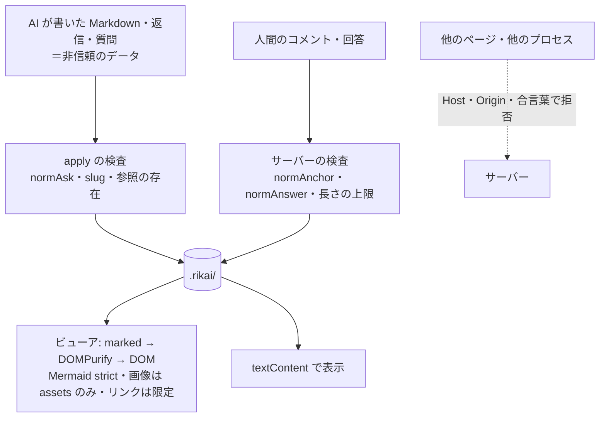

# 構成説明

ファイルの責務・状態の所有・時間と並行・失敗の扱い・信頼の境界。製品要件の正本は [SPEC](../SPEC.md)、設計原則の選択は [参考にした設計原則](references.md)、書き方は [コーディング指針](coding-guidelines.md)。**ここは構造と理由を説明する文書**で、確定 API・動作の保証・検証の結果（[検証手順と記録](verification.md)）は書かない。

## 全体

```mermaid
flowchart LR
    subgraph Agent[エージェント（Claude Code など）]
        SK[SKILL.md<br/>手順を読む]
        CLI[rikai new / open / poll / pull / apply / status]
    end
    subgraph Local[この Mac（127.0.0.1）]
        SV[rikai.js serve<br/>ローカルサーバー]
        FS[(.rikai/&lt;topic&gt;/<br/>meta・threads・pages・rounds・assets)]
        subgraph Browser[ブラウザ]
            APP[app.js ビューア]
        end
    end
    SK --> CLI
    CLI -->|読み書き| FS
    CLI -->|起動・疎通| SV
    SV -->|読み書き| FS
    APP <-->|HTTP + Cookie| SV
    APP -.1.5秒ごとに rev を確認.-> SV
```

流れは、次の 4 つ。**エージェントとサーバーは、互いに通信せず、`.rikai/` のファイルを介して渡し合う**（`poll` は、round のファイルを見に行く）。

1. **作る**：エージェントが `rikai new`（Markdown を標準入力）→ `rikai open`（サーバーの起動・URL）。
2. **コメントする**：人間がビューアで、コメント・回答を書く（サーバーが `threads.json` に下書きとして保存）→ Submit（`rounds/NNN.json` ができる）。
3. **読む**：エージェントの `rikai poll`（または `pull`）が、`pending` の round を出す。
4. **答える**：エージェントが `rikai apply`（返信・新版・子ページ・質問を 1 回で反映）。ビューアが、次の確認で、変更を取り込んで描き直す。

## ファイルの責務

| 場所 | 責務 | 持たないもの |
| --- | --- | --- |
| `skills/rikai/rikai.js` | **CLI の入口**：引数の解釈（`parseArgs`・`projectRoot`）と、各コマンド（`new`・`open`・`poll`・`pull`・`apply`・`status`・`stop`・内部の `serve`）の振り分け（`poll`・`pull`・`apply`・`status` の中身は、`lib/agent.js`）。**起動まわり**（サーバーの起動・疎通・ブラウザを開く・`serve` の終了処理の取りつけ）。**読み込むと動き出す**（`main()`）ので、テストは読み込まない | 画面の描画・資料の中身の解釈・データの検査（`lib/` の仕事） |
| `skills/rikai/lib/util.js` | 共通の小さな道具：`HttpError`・`out`・`now`・`readJSON`・`writeJSON`・`sleep`・入力の整形（`str`・`normAnchor`）。ほかのモジュールに依存しない | |
| `skills/rikai/lib/store.js` | **ストア**：`.rikai/<topic>/` の読み書き・ロック・`mutate`・データの形の版（`SCHEMA`）・トピックの一覧・`newTopic`・`progressOrNull`。**プロジェクトのルート（`ROOT`）と `.rikai`（`BASE`）の状態を持つ**（`setRoot`・`getRoot`・`getBase`） | HTTP・画面の操作・AI 向けの検査 |
| `skills/rikai/lib/ask.js` | **ask の検査**：`normAsk`（AI が出す質問）・`normAnswer`（人の回答） | ファイルの読み書き |
| `skills/rikai/lib/actions.js` | **画面からの操作**（`actions`：`comment`・`reply`・`answer`・`edit`・`delete`・`resolve`・`submit`・`end`）。全トピックが閉じたときの動き `hooks.allClosed`（既定は何もしない。`serve` のプロセスが、終了の処理を入れる） | HTTP |
| `skills/rikai/lib/agent.js` | **AI 向けの操作**：`listRounds`・`peek`（`poll`・`pull` が共有）・`cmdPoll`・`cmdPull`・`cmdApply`（検証してから書く）・`cmdStatus`（出力するコマンドは、`out` で JSON を出す） | HTTP・画面の操作 |
| `skills/rikai/lib/server.js` | **HTTP**：認証（合言葉・`Host`・`Origin`）・配信・ルーティング・`startServer`・`shutdown`。`PORT`・`TOKEN` の状態を持つ | データの検査（`actions` と `store` を呼ぶだけ） |
| `skills/rikai/lib/image.js` | **添付の画像の検査**：形式を中身の先頭のバイトで見分ける（`decodeImage`。png・jpeg・gif・webp だけ。5MB まで）・名前を、中身のハッシュから決める（`c-<16 文字>.<拡張子>`）・名前の形（`IMG_NAME_RE`）・枚数の上限。保存・参照の検査は `actions.js`（`attach`・`normImages`） | ファイルの読み書き・HTTP |
| `skills/rikai/public/app.js` | ビューア。Markdown の描画（無害化）・コメントの位置づけ（選択→アンカー・アンカー→強調）・**コメントの番号と、本文の印・右のカードの対応づけ**（文の番号は CSS の `::after`〔`data-no`〕。**ブロックの番号は、要素の外の層〔`#badges`。`#docscroll` の中の絶対位置〕に、`placeBadges` が出す**：要素の中だと、箱の overflow で切れる・横スクロールで流れる。記事の大きさが変わると、`ResizeObserver` で合わせ直す。マウスを置いたときの光り〔`.linked`〕・入力中の対象の強調〔`mark.pending`・`.blk-pending`。入力欄を閉じると外す〕・入力欄を、対象の位置の順に入れる〔`composerSlot`〕）・**画像・図の中の範囲選択**（`#regbtn`・`#regsel`。範囲は、その要素の大きさに対する比率 `rect`。`cropMedia` が、画像は元の解像度から・svg は画像にして、canvas で切り出して PNG にし、F24 の添付に流す。範囲の枠〔`.regionbox`〕も、`#badges` の層に出す）・パネル・ask の入力・ルーティング（ハッシュ）・サーバーの変更の取り込み | データの正本（サーバーが持つ。ここは写しと下書き）。本文の要素・文字を足すこと（番号・強調は、位置づけに使う本文の文字を変えない形で） |
| `skills/rikai/public/anchor.js` | コメントの探し直しの、**DOM に触れない純粋な関数**：`findQuote`（選んだ文）・`locateBlock`（ブロック）・`similarity`。ブラウザ（`window.RikaiAnchor`）と Node のテスト（`require`）の両方から使う | DOM・ネットワーク |
| `skills/rikai/public/diff.js` | 版どうしの差分の、**DOM に触れない純粋な関数**：`diffText`（文字列のトークン単位の差分）・`matchBlocks`（ブロックの対応づけ）。`anchor.js` の `similarity` を使う。ブラウザ（`window.RikaiDiff`）と Node のテスト（`require`）の両方から使う | DOM・ネットワーク |
| `skills/rikai/public/progress.js` | 理解の進み具合を数える、**DOM に触れない純粋な関数**（`progressOf`）：解決したスレッドの数・全スレッド・AI の質問の数・送信済みの回答がある数。**数だけ**で、理解の判定ではない。ブラウザ（`window.RikaiProgress`）・サーバー（`lib/store.js` の `progressOrNull`〔一覧〕と `rikai.js` の `status` が `require`）・Node のテストの 3 つが共有する | DOM・ネットワーク |
| `skills/rikai/public/fmt.js` | 資料の「形式」の、**DOM に触れない純粋な関数**：コードブロックの種類（`diff`・`json`・`terminal`〔`ansi`〕・`trace`）から、HTML の文字列を作る（`render`）。**文字は、必ず、ここで escape して、決まったタグ・クラスの中に入れる**（資料の文字が、タグ・属性にならない）。`style` は使えない（無害化で消える）ので、trace の棒の位置・長さは、`data-s`・`data-w` の数で持ち、ビューア（`mdToFragment`）が、無害化のあとに設定する。ブラウザ（`window.RikaiFmt`）と Node のテストの両方から使う | DOM・ネットワーク |
| `skills/rikai/public/index.html`・`style.css` | 画面の骨組みと見た目 | ロジック |
| `skills/rikai/public/vendor/` | 同梱の marked・DOMPurify・mermaid と、ライセンス。**書き換えない** | |
| `skills/rikai/SKILL.md` | AI への手順（資料の作り方・待ち方・返信の方針・`apply` の入力）。コマンドの仕様の**利用者側の説明** | コマンドの実装 |
| `install.sh` | `skills/rikai/` を `~/.claude/skills/rikai/` へ複製（`rsync --delete`） | |
| `plugin.json`・`.claude-plugin/`・`.agents/plugins/marketplace.json`・`package.json`（`pi`） | **プラグインの宣言**（中身は、どれも同じ `skills/rikai/`。ルートがプラグインのルート）。`plugin.json`：codex・omp・agy（Agent Plugins 1.0.0）。`.claude-plugin/`：Claude Code・grok（plugin.json と marketplace.json）。`.agents/plugins/marketplace.json`：codex のカタログ。`package.json` の `pi`：pi。実行時のコードではない | ロジック・コマンドの実装。版は、`package.json` と `plugin.json` だけ（`.claude-plugin/` には書かない） |

### サーバーの API（`lib/server.js`）

すべて、合言葉の Cookie（`rikai_t_<ポート>`。または `X-Rikai-Token` ヘッダー）が要る（`/` の最初の 1 回は `?t=`）。Cookie の名前にポートを入れるのは、ブラウザの Cookie が、ポートで分かれないため（別のプロジェクトのサーバーが、上書きしない）。

| 経路 | 内容 |
| --- | --- |
| `GET /` ほか（`/app.js`・`/style.css`・`/favicon.svg`・`/vendor/*`） | 画面。`/` は、`?t=` が正しければ Cookie を付けて `/` へ 302（URL から合言葉を外す）。`Content-Security-Policy` つき。静的ファイルは、`public/` の外へ出ない |
| `GET /asset/<topic>/<path>` | `.rikai/<topic>/assets/` の画像だけ。`public` の外・`assets/` の外へ出ない。`Content-Security-Policy: sandbox` つき |
| `GET /api/ping`・`/api/topics`・`/api/topic/<slug>?since=<rev>`・`/api/page/<slug>/<page>/<版>` | 疎通・トピックの一覧（読めるトピックには `progress`。一覧の更新のたびに、各トピックの `threads.json` を読む）・トピックの状態（`rev` が同じなら `unchanged`）・資料の Markdown |
| `POST /api/comment`・`reply`・`answer`・`edit`・`delete`・`resolve`・`submit`・`end`・`attach` | 画面からの操作（`actions` の同名の関数）。本体は JSON（2 MB まで。**`attach` だけは、画像（base64）のため、約 7MB まで**）。結果は `{ok:true,…}`、失敗は `{ok:false,error}`。`attach` は、画像を `assets/` に、ロックの下で保存し、名前を返す。`comment`・`reply` は、`images`（その名前の配列）を受ける |

## 状態の所有

状態の所有者は 1 か所。書くのは、**`mutate()`（ロックの下）だけ**。

| 状態 | 所有者 | 場所・形 | 備考 |
| --- | --- | --- | --- |
| ページ木・版の数・題名・round の番号・未処理の round・閉じたか・`rev`・データの形の版（`schema`） | `lib/store.js`（`mutate`） | `.rikai/<topic>/meta.json` | 保存のたびに `rev` を 1 つ上げ、`schema` を書く（画面が、変更を見つける印）。このコードより新しい `schema` は、読み書きを断る（`loadMeta`。409） |
| スレッド・メッセージ・解決・送信済みか | `lib/store.js`（`mutate`） | `.rikai/<topic>/threads.json`（`seq` で ID `t…`・`m…` を採番） | 人間の発言は `sent:false`（下書き）で入り、Submit で `true` になる |
| 資料の各版 | `rikai new`・`apply` だけが作る | `.rikai/<topic>/pages/<page>/v<N>.md` | **作ったあとは書き換えない** |
| Submit の送信内容 | `submit`（作る）・`apply`（`handled` にする） | `.rikai/<topic>/rounds/NNN.json` | `pending` → `handled`。`poll`・`pull` は、`pending` の最初のものを出す |
| 画像 | 資料の画像は、人（またはエージェント）が置く。**コメント・返信の添付は、`attach`（ロックの下）が書く** | `.rikai/<topic>/assets/` | 読むだけ（`/asset/`）。メッセージには、名前だけを持つ（`images`）。Submit の出力で、絶対パスにする。使われなかった画像は残る（掃除はしない） |
| サーバーの情報 | `serve`（作る・消す）・CLI（読む） | `.rikai/.server.json`（pid・ポート・合言葉） | 疎通しなければ、古いものとして消して起こし直す |
| ブラウザの状態 | `app.js` の `S` | メモリ | 表示中のトピック・ページ・版・パネルの下書き・開いている入力。再読み込みで消える（下書きのコメントはサーバーが持つので消えない。**ask の選びかけ・返信欄の入力は、消える**） |
| 既読の AI の発言 | `app.js` | `localStorage` の `rikai-seen` | 「AIの返信」の印を消すための印。サーバーには送らない |
| 画面の広さ（左の一覧をしまう・右のコメントの幅） | `app.js`（`UI`） | `localStorage` の `rikai-ui`（`sideOpen`・`panelW`・`wide`） | このブラウザだけ。サーバー・資料・コメントとは別。壊れていたら既定に戻る。ウィンドウの幅に応じて、右の幅の上限（70%）に収める |

トピックを作った直後の構造：

```text
.rikai/
  .gitignore            `*`（rikai が、なければ作る）
  .server.json          起動中のサーバーの情報
  .server.log           サーバーの標準出力・エラー
  <topic>/
    meta.json
    threads.json
    pages/root/v1.md    以降 v2.md …。子ページは pages/<id>/v1.md …
    assets/
    rounds/001.json …
    .lock/              変更中だけある（ロック）
```

## 時間と並行

- **ロック**：トピックごとの `mkdir .lock`（排他）。取れなければ 30 ミリ秒ごとに再試行し、**8 秒で諦める**。15 秒より古いロックは、残骸として外す。`mutate` の中は同期の処理だけ（`await` を入れない）。待つ間は `Atomics.wait` で止まる（サーバーのイベントループも止まる。起きるのは、`apply` と画面の操作が重なったときだけ）。
- **書き込み**：JSON は、一時ファイルへ書いて `rename`（途中の内容を読ませない）。`mutate` は、`fn` が投げたら、何も書かない（`threads.json`・`meta.json` とも）。
- **`poll`**：500 ミリ秒ごとに、`meta.json` と `rounds/` を読む。サーバーには問い合わせない（サーバーが止まっても、round のファイルがあれば出せる）。`pending` の round は、`closed` より先に出す（人間が Submit してすぐ終了しても、届く）。
- **画面の更新**：ビューアが 1.5 秒ごとに `/api/topic/<slug>?since=<rev>` と `/api/topics` を見る。`rev` が変わったときだけ描き直す。**サーバーからの押し出し（WebSocket・SSE）はない**。
- **描き直しでの保護**：資料の再描画は、「ページ・版・変更の印・コメントのアンカー」が変わったときだけ（`docSigOf`。選択の最中に消えないように）。パネルは、描き直す前に、入力中の欄（`data-key`）とカーソルを覚え、描いたあとに戻す。Mermaid は、ソースごとに描いた SVG を `svgCache` に覚える。
- **サーバーの寿命**：プロジェクトごとに 1 つ。`rikai open` が起こし（デタッチ）、すべてのトピックが閉じる（`end`）と終了する。`rikai stop` でも止まる。

## 信頼の境界



| 境界 | 何を検査するか | 場所 |
| --- | --- | --- |
| サーバーへの入口 | `Host`（127.0.0.1／localhost とポート）・`Origin`・合言葉（定数時間の比較）・本体の大きさ（2 MB）・`topic` の形（`SLUG_RE`） | `denyReason`・`readBody`・`checkSlug` |
| ファイルの配信 | 解決したパスが、`public/`・`assets/` の中にあること | `handler` |
| 画面からの操作 | ページの存在・版が最新か・空でないこと・スレッドとメッセージの存在・送信済みは変えない・アンカーと文字数の正規化・回答を ask に照らす | `actions`・`normAnchor`・`normAnswer` |
| `apply` | すべてを検証してから書く：ID の形と重複・親や参照先の存在・`ask` の形・同じページの二重の改訂・round の存在。1 つでも誤りがあれば何も書かない | `cmdApply`・`normAsk` |
| 資料の描画 | DOMPurify（`PURIFY`：HTML＋SVG の許可、`style`・`script`・`iframe`・フォーム部品・`on*` などを除く。URI は `https?`・`mailto`・`page:` だけ）→ リンク（`page:` は内部の遷移、`http(s)` は別タブ・`noopener`）→ 画像（`data:image/` と `assets/` の相対パスだけ。外部 URL は置き換え） | `mdToFragment` |
| 図 | Mermaid `securityLevel: 'strict'`。図のソースは、属性に **URI エンコードして**持つ（DOMPurify は、`-->` を含む属性値を、属性ごと消す） | `marked.use` の `code`・`fillMermaid` |
| 人間の文 | コメント・返信・編集の文は、`textContent`（HTML にしない） | `renderMessage` |
| 画面の保護 | `Content-Security-Policy`（`script-src 'self'`・`connect-src 'self'`・`frame-src 'none'`…）。`/asset/` は `sandbox` | `INDEX_CSP`・`handler` |

## コメントの位置づけ

- **アンカー**：`{blockId, blockHash, blockTag, blockText, quote, prefix, suffix, label}`。選んだ文のときは `quote`（最大 2000 文字）と前後 32 文字（`blockId`・`blockHash` は、選んだ文のあるブロック）。ブロックのときは `quote` が空で、`label`（「図」「表」など）と、ブロックの識別（`blockId`・`blockHash`）・種類（`blockTag`。タグ名）・内容の抜粋（`blockText`。200 文字まで）。
- **ブロック**：本文の直下の子と、リストの直下の項目（`blockEls`）。描画のたびに、順番で `b0`・`b1`…、内容の要約で `blockHash`（djb2）を付ける。
- **選択 → アンカー**：本文の文字（図・`style`・`script` の中を除く）を連結した 1 本の文字列（`textIndex`）の上で、選択の始点・終点の位置を求める（`boundaryOffset`）。空白だけの両端は外す。図の中の選択は、図のブロックへのコメントにする。
- **アンカー → 強調**：`findQuote`（human-review の考え方を借りた）。`quote` が 1 か所ならそこ、複数なら前後の文脈の一致が最も長いもの。なければ、空白をまとめて再度探す。見つかった範囲の文字ノードごとに `<mark class="hl" data-tid>` で包む。
- **ブロックの探し直し**（`locateBlock`。ブロックは `{id, hash, tag, text}` の並びで渡す）：(1) `blockHash` が同じブロック（確実。複数あれば、`blockId` が同じものを先に）→ (2) 同じ種類（`blockTag`）で、内容の抜粋（`blockText`。200 文字まで）が近いブロック（文字の 2 つ組の Dice 係数が 0.5 以上で最大のもの。**推定**）→ (3) 同じ種類の、`blockId` が同じブロック（**推定**）。見つからなければ見つからない扱い。推定のときは、パネルに「近い内容のブロックに表示」「同じ位置のブロックに表示」の印を出し、人間が確かめられるようにする。
- 見つからないスレッドは、パネルに残し、「修正で文が変わりました」と出す。作成した版より前の版を見ているときは、本文に出さない（「後の版のコメント」）。

## 版

- `revisions` の `markdown` は**全文**（差分ではない）。`meta.json` の `pages[id].versions` が増え、`pages/<id>/v<N>.md` が増える。
- 返信（AI のメッセージ）に、そのときのページの新しい版（`revision`）を持たせる。
- **差分**（v2 以降の版を見ているとき。その版の、前の版との差分。`addDiff`）：前の版の Markdown も、同じ手順（marked → DOMPurify → ブロックの番号と内容の要約）で描画し、ブロックを `matchBlocks` で対応づける。(1) 同じ内容（`blockHash`）を、最長共通部分列で、**順序を保って**対応づける。(2) 残りを、**同じ「同じ」ブロックの間の区間の中**（区間の中では、入れ替わりも許す）で、同じ種類（タグ）かつ内容が近いものどうし（ブロックの文字の先頭 200 字の `similarity` が 0.5 以上。高い順）。**近さを調べる組の数（区間ごとの、前と今のブロック数の積）には、全体で 2 万の予算がある。前の区間から順に使い、残りの予算を超える区間は、近さを調べず、追加と削除にする**。(3) 残りの今のブロックは「追加」、前のブロックは「なくなった」。「変更」のブロックだけ、`diffText` で文字（トークン）の差分を求め、ブロックの直後に `<details class="diffbox">` で足す（箇条書きの項目は `<li class="diffbox">`。`display: block`：番号つきの並びで、番号を使わないため）。なくなったブロックは、本文の最後に折りたたみで足す（文字のないブロックは、ラベル）。**差分の箱は、ブロックではない**（`blockEls` が除き、`textIndex` が文字を拾わず、箱から選び始めた選択は、アンカーを作らない。**終わりだけが箱に入った選択は、本文の分だけがアンカーになる**）。ブロックを足す前に、番号と内容の要約を付けるので、コメントの位置づけ・探し直しは、差分の有無で変わらない。差分に使う文字は、ブロックの文字（表は、セルを「 | 」、行を改行でつなぐ。図は、ソース。属性の壊れた値は、そのまま）。表示は `textContent`（HTML にしない）。**差分の計画（対応づけと文字の差分）は、1 つだけ覚える**（`S.diffCache`。版の印と、Markdown の中身が同じときだけ使う。コメントの操作のたびに、やり直さない）。上のバーの件数には、どの版のものかの印を付ける。

## 失敗の扱い

- 内部の失敗は `HttpError(status, message)`。HTTP では `{ok:false,error}` と状態コード。コマンドでは `{ok:false,errors:[…]}` を出して、終了コード 1。想定外の例外は、HTTP では 500（「内部エラー」）で、標準エラーに出す。
- 画面は、失敗をトーストで見せる（`act`）。サーバーに届かなくなったら、上のバーに「サーバーに接続できません」を出す（`tick`）。
- 失敗を、成功に見える代用品にしない：`apply` は、部分的に反映しない。人間の操作は、最新版以外・送信済み・存在しない対象を、受けない。

## 既知の構造上の負債

見直しの候補。直したら、この節から消す。

- **ファイルが大きい**：`app.js` は、500 行を超える（2026-11-21 の時点で、約 910 行）。ブラウザで、ビルドなしの script タグなので、分けるには、読み込み順とグローバルの扱いを決める必要があり、自動テストの保護もない（DOM を使うため）。**`rikai.js` は、`lib/` に分けた**（RIK-007。最大は `lib/server.js` の約 190 行・`lib/agent.js` の約 170 行・`lib/store.js` の約 160 行）。
- **自動テストの範囲**：`npm test`（Node 標準の `node:test`）が、ストア・画面からの操作・`apply`・ask・`peek`・アンカーの探し直し・サーバーの入口を試す（[開発手順](development.md#検証の入口)）。**対象外**：ビューア（DOM）。無害化（DOMPurify）・描画・選択・パネルは、ブラウザでの手作業の確認だけ。ロックの競合（`sleepSync`）・`poll` の待ち（時間）も、試していない。
- **古いコメントは、ブロックの種類・抜粋を持たない**：`blockTag`・`blockText` を足した（2026-11-21）より前のブロックへのコメントは、それらを持たない。そのときは、種類を問わず、内容の抜粋なしで、同じ内容（`blockHash`）か、同じ位置（`blockId`）しか探せない。移行（版 2）は、まだない。
- **ロックの待ちが、イベントループを止める**：`mutate` の同期の待ち（最大 8 秒）。通常はすぐ取れるが、CLI の `apply` が長く掴むと、サーバーが、その間、止まる。
- **ブロックへのコメントの推定は、粗い**：2 つ組の Dice 係数の閾値（0.5）は、仮の値（試した範囲は、表の 1 か所の書き換え。単体テストと、ブラウザでの 1 例）。大きく書き換えた資料での当たり方は、測っていない。
- **ビューアの再描画が全面的**：資料・パネルを、変更のたびに丸ごと描き直す（入力欄の保存で補っている）。長い資料・大量のスレッドでの速さは、測っていない。
- **ブラウザの状態が、再読み込みで消える**：ask の選びかけ・返信欄の入力は、メモリだけ。
- **差分の計算量**：`diffText` は、前後の同じ部分を除いたあと、トークン数の積が 100 万を超えると、丸ごとの置き換えにする（固まらないため。999×1000 トークンで約 7 ms）。`matchBlocks` は、(a) ブロック数の積が 400 万を超えると、順序を保つ表を作らず、同じ内容を先頭から対応づける（そのあとの、近さによる対応づけは、同じように行う）、(b) 近さを調べる組の数に、**全体で 2 万の予算**がある（使い切ると、残りの区間は、追加と削除）。**これらの上限の値は、実際の資料で決めたものではない**。レビューは、予算がない版で、全部を書き直した 200×200 ブロック（各 400 字）の区間で約 1 秒、これが 10 区間で約 9.5 秒、各 120 字なら約 2.7 秒と測った。予算を 2 万・先頭 200 字にした版の、同じ形での時間は、**測っていない**。覚える計画は 1 つなので、重い 2 つの版を行き来すると、毎回計算し直す。日本語は 1 文字ずつなので、長い文を直すと、差分が細かく割れて見えることがある（語の境界は、見ていない）。
- **壊れた `meta.json` が 1 つあると、一覧（`/api/topics`）が 500 になる**：`listTopics` が、JSON として読めないファイルで投げる。画面は、上のバーに「サーバーのエラー: 内部エラー」を出し、読めるトピックの表示は続く（2026-11-21 にブラウザで確認）。壊れたトピックだけを、一覧から外す（または印をつける）かは、決めていない。**壊れた `threads.json` は、一覧を落とさない**：そのトピックの `progress` だけが `null`（警告は、トピックごとに 1 回、標準エラーへ。ファイルの中身は出さない）。そのトピックを開くと、これまでどおり、500。
- **一覧の更新のたびに、全トピックの `threads.json` を読む**：`/api/topics` の `progress` のため（ビューアは 1.5 秒ごとに呼ぶ）。レビューの測定：20 トピック × 300 スレッド × 8 メッセージ（1 ファイル約 1.5 MB）で、1 回約 27 ms（同期）。通常のデータは、はるかに小さい。`rev` ごとに覚える方法があるが、まだ入れていない。
