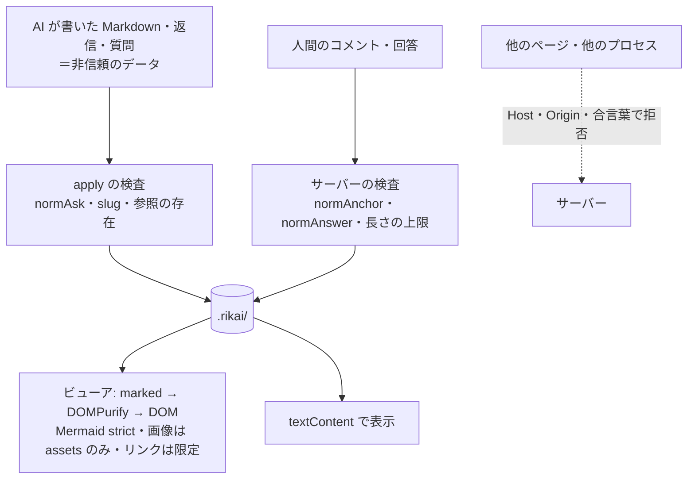

# 構成説明

ファイルの責務・状態の所有・時間と並行・失敗の扱い・信頼の境界。製品要件の正本は [SPEC](../SPEC.md)、設計原則の選択は [参考にした設計原則](references.md)、書き方は [コーディング指針](coding-guidelines.md)。**ここは構造と理由を説明する文書**で、確定 API・動作の保証・検証の結果（[検証手順と記録](verification.md)）は書かない。

## 全体

```mermaid
flowchart LR
    subgraph Agent[エージェント（Claude Code など）]
        SK[SKILL.md<br/>手順を読む]
        CLI[rikai new / open / poll / pull / apply / status]
    end
    subgraph Local[この Mac（127.0.0.1）]
        SV[rikai.js serve<br/>ローカルサーバー]
        FS[(.rikai/&lt;topic&gt;/<br/>meta・threads・pages・rounds・assets)]
        subgraph Browser[ブラウザ]
            APP[app.js ビューア]
        end
    end
    SK --> CLI
    CLI -->|読み書き| FS
    CLI -->|起動・疎通| SV
    SV -->|読み書き| FS
    APP <-->|HTTP + Cookie| SV
    APP -.1.5秒ごとに rev を確認.-> SV
```

流れは、次の 4 つ。**エージェントとサーバーは、互いに通信せず、`.rikai/` のファイルを介して渡し合う**（`poll` は、round のファイルを見に行く）。

1. **作る**：エージェントが `rikai new`（Markdown を標準入力）→ `rikai open`（サーバーの起動・URL）。
2. **コメントする**：人間がビューアで、コメント・回答を書く（サーバーが `threads.json` に下書きとして保存）→ Submit（`rounds/NNN.json` ができる）。
3. **読む**：エージェントの `rikai poll`（または `pull`）が、`pending` の round を出す。
4. **答える**：エージェントが `rikai apply`（返信・新版・子ページ・質問を 1 回で反映）。ビューアが、次の確認で、変更を取り込んで描き直す。

## ファイルの責務

| 場所 | 責務 | 持たないもの |
| --- | --- | --- |
| `skill/rikai/rikai.js` | コマンド（`new`・`open`・`poll`・`pull`・`apply`・`status`・`stop`・内部の `serve`）と、サーバー。**ストア**（`.rikai/` の読み書き・ロック・`mutate`）・**ask の検査**・**画面からの操作**（`actions`）・**AI 向けの操作**（`cmdPoll`・`cmdPull`・`cmdApply`・`cmdStatus`）・**HTTP**（認証・配信・ルーティング）・**起動まわり**（サーバーの起動・疎通・ブラウザを開く） | 画面の描画・資料の中身の解釈（Markdown は、ただの文字列として保存する） |
| `skill/rikai/public/app.js` | ビューア。Markdown の描画（無害化）・コメントの位置づけ（選択→アンカー・アンカー→強調）・パネル・ask の入力・ルーティング（ハッシュ）・サーバーの変更の取り込み | データの正本（サーバーが持つ。ここは写しと下書き） |
| `skill/rikai/public/index.html`・`style.css` | 画面の骨組みと見た目 | ロジック |
| `skill/rikai/public/vendor/` | 同梱の marked・DOMPurify・mermaid と、ライセンス。**書き換えない** | |
| `skill/rikai/SKILL.md` | AI への手順（資料の作り方・待ち方・返信の方針・`apply` の入力）。コマンドの仕様の**利用者側の説明** | コマンドの実装 |
| `install.sh` | `skill/rikai/` を `~/.claude/skills/rikai/` へ複製（`rsync --delete`） | |

### サーバーの API（`rikai.js`）

すべて、合言葉の Cookie（または `X-Rikai-Token` ヘッダー）が要る（`/` の最初の 1 回は `?t=`）。

| 経路 | 内容 |
| --- | --- |
| `GET /` ほか（`/app.js`・`/style.css`・`/favicon.svg`・`/vendor/*`） | 画面。`/` は、`?t=` が正しければ Cookie を付けて `/` へ 302（URL から合言葉を外す）。`Content-Security-Policy` つき。静的ファイルは、`public/` の外へ出ない |
| `GET /asset/<topic>/<path>` | `.rikai/<topic>/assets/` の画像だけ。`public` の外・`assets/` の外へ出ない。`Content-Security-Policy: sandbox` つき |
| `GET /api/ping`・`/api/topics`・`/api/topic/<slug>?since=<rev>`・`/api/page/<slug>/<page>/<版>` | 疎通・トピックの一覧・トピックの状態（`rev` が同じなら `unchanged`）・資料の Markdown |
| `POST /api/comment`・`reply`・`answer`・`edit`・`delete`・`resolve`・`submit`・`end` | 画面からの操作（`actions` の同名の関数）。本体は JSON（2 MB まで）。結果は `{ok:true,…}`、失敗は `{ok:false,error}` |

## 状態の所有

状態の所有者は 1 か所。書くのは、**`mutate()`（ロックの下）だけ**。

| 状態 | 所有者 | 場所・形 | 備考 |
| --- | --- | --- | --- |
| ページ木・版の数・題名・round の番号・未処理の round・閉じたか・`rev` | `rikai.js`（`mutate`） | `.rikai/<topic>/meta.json` | 保存のたびに `rev` を 1 つ上げる（画面が、変更を見つける印） |
| スレッド・メッセージ・解決・送信済みか | `rikai.js`（`mutate`） | `.rikai/<topic>/threads.json`（`seq` で ID `t…`・`m…` を採番） | 人間の発言は `sent:false`（下書き）で入り、Submit で `true` になる |
| 資料の各版 | `rikai new`・`apply` だけが作る | `.rikai/<topic>/pages/<page>/v<N>.md` | **作ったあとは書き換えない** |
| Submit の送信内容 | `submit`（作る）・`apply`（`handled` にする） | `.rikai/<topic>/rounds/NNN.json` | `pending` → `handled`。`poll`・`pull` は、`pending` の最初のものを出す |
| 画像 | 人（またはエージェント）が置く | `.rikai/<topic>/assets/` | 読むだけ（`/asset/`） |
| サーバーの情報 | `serve`（作る・消す）・CLI（読む） | `.rikai/.server.json`（pid・ポート・合言葉） | 疎通しなければ、古いものとして消して起こし直す |
| ブラウザの状態 | `app.js` の `S` | メモリ | 表示中のトピック・ページ・版・パネルの下書き・開いている入力。再読み込みで消える（下書きのコメントはサーバーが持つので消えない。**ask の選びかけ・返信欄の入力は、消える**） |
| 既読の AI の発言 | `app.js` | `localStorage` の `rikai-seen` | 「AIの返信」の印を消すための印。サーバーには送らない |

トピックを作った直後の構造：

```text
.rikai/
  .gitignore            `*`（rikai が、なければ作る）
  .server.json          起動中のサーバーの情報
  .server.log           サーバーの標準出力・エラー
  <topic>/
    meta.json
    threads.json
    pages/root/v1.md    以降 v2.md …。子ページは pages/<id>/v1.md …
    assets/
    rounds/001.json …
    .lock/              変更中だけある（ロック）
```

## 時間と並行

- **ロック**：トピックごとの `mkdir .lock`（排他）。取れなければ 30 ミリ秒ごとに再試行し、**8 秒で諦める**。15 秒より古いロックは、残骸として外す。`mutate` の中は同期の処理だけ（`await` を入れない）。待つ間は `Atomics.wait` で止まる（サーバーのイベントループも止まる。起きるのは、`apply` と画面の操作が重なったときだけ）。
- **書き込み**：JSON は、一時ファイルへ書いて `rename`（途中の内容を読ませない）。`mutate` は、`fn` が投げたら、何も書かない（`threads.json`・`meta.json` とも）。
- **`poll`**：500 ミリ秒ごとに、`meta.json` と `rounds/` を読む。サーバーには問い合わせない（サーバーが止まっても、round のファイルがあれば出せる）。`pending` の round は、`closed` より先に出す（人間が Submit してすぐ終了しても、届く）。
- **画面の更新**：ビューアが 1.5 秒ごとに `/api/topic/<slug>?since=<rev>` と `/api/topics` を見る。`rev` が変わったときだけ描き直す。**サーバーからの押し出し（WebSocket・SSE）はない**。
- **描き直しでの保護**：資料の再描画は、「ページ・版・変更の印・コメントのアンカー」が変わったときだけ（`docSigOf`。選択の最中に消えないように）。パネルは、描き直す前に、入力中の欄（`data-key`）とカーソルを覚え、描いたあとに戻す。Mermaid は、ソースごとに描いた SVG を `svgCache` に覚える。
- **サーバーの寿命**：プロジェクトごとに 1 つ。`rikai open` が起こし（デタッチ）、すべてのトピックが閉じる（`end`）と終了する。`rikai stop` でも止まる。

## 信頼の境界



| 境界 | 何を検査するか | 場所 |
| --- | --- | --- |
| サーバーへの入口 | `Host`（127.0.0.1／localhost とポート）・`Origin`・合言葉（定数時間の比較）・本体の大きさ（2 MB）・`topic` の形（`SLUG_RE`） | `denyReason`・`readBody`・`checkSlug` |
| ファイルの配信 | 解決したパスが、`public/`・`assets/` の中にあること | `handler` |
| 画面からの操作 | ページの存在・版が最新か・空でないこと・スレッドとメッセージの存在・送信済みは変えない・アンカーと文字数の正規化・回答を ask に照らす | `actions`・`normAnchor`・`normAnswer` |
| `apply` | すべてを検証してから書く：ID の形と重複・親や参照先の存在・`ask` の形・同じページの二重の改訂・round の存在。1 つでも誤りがあれば何も書かない | `cmdApply`・`normAsk` |
| 資料の描画 | DOMPurify（`PURIFY`：HTML＋SVG の許可、`style`・`script`・`iframe`・フォーム部品・`on*` などを除く。URI は `https?`・`mailto`・`page:` だけ）→ リンク（`page:` は内部の遷移、`http(s)` は別タブ・`noopener`）→ 画像（`data:image/` と `assets/` の相対パスだけ。外部 URL は置き換え） | `mdToFragment` |
| 図 | Mermaid `securityLevel: 'strict'`。図のソースは、属性に **URI エンコードして**持つ（DOMPurify は、`-->` を含む属性値を、属性ごと消す） | `marked.use` の `code`・`fillMermaid` |
| 人間の文 | コメント・返信・編集の文は、`textContent`（HTML にしない） | `renderMessage` |
| 画面の保護 | `Content-Security-Policy`（`script-src 'self'`・`connect-src 'self'`・`frame-src 'none'`…）。`/asset/` は `sandbox` | `INDEX_CSP`・`handler` |

## コメントの位置づけ

- **アンカー**：`{blockId, blockHash, quote, prefix, suffix, label}`。選んだ文のときは `quote`（最大 2000 文字）と前後 32 文字。ブロックのときは `quote` が空で、`label`（「図」「表」など）と、ブロックの識別。
- **ブロック**：本文の直下の子と、リストの直下の項目（`blockEls`）。描画のたびに、順番で `b0`・`b1`…、内容の要約で `blockHash`（djb2）を付ける。
- **選択 → アンカー**：本文の文字（図・`style`・`script` の中を除く）を連結した 1 本の文字列（`textIndex`）の上で、選択の始点・終点の位置を求める（`boundaryOffset`）。空白だけの両端は外す。図の中の選択は、図のブロックへのコメントにする。
- **アンカー → 強調**：`findQuote`（human-review の考え方を借りた）。`quote` が 1 か所ならそこ、複数なら前後の文脈の一致が最も長いもの。なければ、空白をまとめて再度探す。見つかった範囲の文字ノードごとに `<mark class="hl" data-tid>` で包む。ブロックのときは、`blockHash` の一致、または**作成した版を見ているとき**の `blockId` で探し、そのブロックに印を付ける。
- 見つからないスレッドは、パネルに残し、「修正で文が変わりました」と出す。作成した版より前の版を見ているときは、本文に出さない（「後の版のコメント」）。

## 版

- `revisions` の `markdown` は**全文**（差分ではない）。`meta.json` の `pages[id].versions` が増え、`pages/<id>/v<N>.md` が増える。
- 返信（AI のメッセージ）に、そのときのページの新しい版（`revision`）を持たせる。
- 変更の印：最新版（2 以上）を見ているとき、前の版の Markdown も描画して、ブロックの `blockHash` の集合と比べ、現在の版にしかないブロックに `changed` を付ける（ブロック単位。ブロックの中の差分は見ない）。

## 失敗の扱い

- 内部の失敗は `HttpError(status, message)`。HTTP では `{ok:false,error}` と状態コード。コマンドでは `{ok:false,errors:[…]}` を出して、終了コード 1。想定外の例外は、HTTP では 500（「内部エラー」）で、標準エラーに出す。
- 画面は、失敗をトーストで見せる（`act`）。サーバーに届かなくなったら、上のバーに「サーバーに接続できません」を出す（`tick`）。
- 失敗を、成功に見える代用品にしない：`apply` は、部分的に反映しない。人間の操作は、最新版以外・送信済み・存在しない対象を、受けない。

## 既知の構造上の負債

見直しの候補。直したら、この節から消す。

- **ファイルが大きい**：`rikai.js`・`app.js` は、どちらも 500 行を超える（2026-11-21 の時点で、約 790 行・約 840 行）。`rikai.js` は、ストア・HTTP・コマンドが 1 ファイルにある。Node の標準だけで足りる・配布が簡単、を優先した。分けるなら、ストア／サーバー／コマンドの境目（`// ----` の見出し）で。
- **自動テストがない**：検証は、コマンドとブラウザの手作業（[検証手順と記録](verification.md)）。`apply` の検証・`normAnswer`・アンカーの探し直し（`findQuote`）・`mutate` の「失敗なら書かない」は、画面・サーバーから分けて試せる形にあるが、まだ試していない。
- **データの形の版がない**：`meta.json`・`threads.json` に、スキーマの版がない。形を変えると、既存の `.rikai/` を読めなくなりうる（SPEC §7）。
- **ブロックへのコメントの追従が弱い**：内容が変わったブロックは、作成した版でしか順番で探さない。直された表・段落へのコメントは、新しい版で見つからなくなりうる（SPEC F12）。
- **ロックの待ちが、イベントループを止める**：`mutate` の同期の待ち（最大 8 秒）。通常はすぐ取れるが、CLI の `apply` が長く掴むと、サーバーが、その間、止まる。
- **`cmdApply` に、何もしない分岐がある**：`threads` の検査にある、新規ページを許す分岐が空（`rikai.js`）。意図の説明のために残っている。整理する。
- **ビューアの再描画が全面的**：資料・パネルを、変更のたびに丸ごと描き直す（入力欄の保存で補っている）。長い資料・大量のスレッドでの速さは、測っていない。
- **ブラウザの状態が、再読み込みで消える**：ask の選びかけ・返信欄の入力は、メモリだけ。
- **`.rikai/.server.json` の合言葉**：ファイルに平文で置き、権限を絞っていない（`writeFileSync` の既定。umask しだいで、同じ Mac の別のユーザーが読める状態でありうる。実際の権限は、確認していない）。絞る（0600）かを、判断する。
