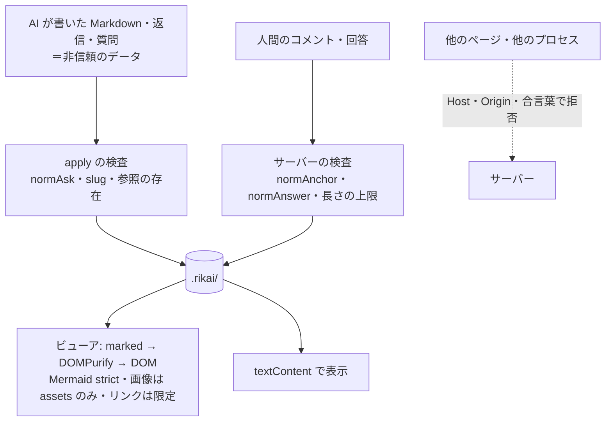

# 構成説明

ファイルの責務・状態の所有・時間と並行・失敗の扱い・信頼の境界。製品要件の正本は [SPEC](../SPEC.md)、設計原則の選択は [参考にした設計原則](references.md)、書き方は [コーディング指針](coding-guidelines.md)。**ここは構造と理由を説明する文書**で、確定 API・動作の保証・検証の結果（[検証手順と記録](verification.md)）は書かない。

## 全体

```mermaid
flowchart LR
    subgraph Agent[エージェント（Claude Code など）]
        SK[SKILL.md<br/>手順を読む]
        CLI[rikai new / open / poll / pull / apply / status]
    end
    subgraph Local[この Mac（127.0.0.1）]
        SV[rikai.js serve<br/>ローカルサーバー]
        FS[(.rikai/&lt;topic&gt;/<br/>meta・threads・pages・rounds・assets)]
        subgraph Browser[ブラウザ]
            APP[画面（React）<br/>app/src/web]
        end
    end
    SK --> CLI
    CLI -->|読み書き| FS
    CLI -->|起動・疎通| SV
    SV -->|読み書き| FS
    APP <-->|HTTP + Cookie| SV
    APP -.1.5秒ごとに rev を確認.-> SV
```

流れは、次の 4 つ。**エージェントとサーバーは、互いに通信せず、`.rikai/` のファイルを介して渡し合う**（`poll` は、round のファイルを見に行く）。

1. **作る**：エージェントが `rikai new`（Markdown を標準入力）→ `rikai open`（サーバーの起動・URL）。
2. **コメントする**：人間がビューアで、コメント・回答を書く（サーバーが `threads.json` に下書きとして保存）→ Submit（`rounds/NNN.json` ができる）。
3. **読む**：エージェントの `rikai poll`（または `pull`）が、`pending` の round を出す。
4. **答える**：エージェントが `rikai apply`（返信・新版・子ページ・質問を 1 回で反映）。ビューアが、次の確認で、変更を取り込んで描き直す。

## ファイルの責務

| 場所 | 責務 | 持たないもの |
| --- | --- | --- |
| `app/src/cli/main.ts`（バンドル：`skills/rikai/rikai.js`） | **CLI の入口**：各コマンド（`new`・`open`・`poll`・`pull`・`apply`・`status`・`stop`・内部の `serve`）の振り分け（`poll`・`pull`・`apply`・`status` の中身は、`server/agent.ts` の `createAgent`）。**起動まわり**（サーバーの起動・疎通〔`ensureServer`〕・ブラウザを開く・`serve` の終了処理〔`hooks.allClosed` へ `shutdown`〕の取りつけ）・`HELP`。**読み込むと動き出す**（末尾の `main()`）ので、テストは読み込まず、バンドルを子プロセスで動かす（`app/test/setup/cli.ts`） | 画面の描画・資料の中身の解釈・データの検査（`server/` の仕事） |
| `app/src/cli/args.ts` | **引数の解釈**：`parseArgs`・`projectRoot`。副作用がない | コマンドの実行 |
| `app/src/server/util.ts` | 共通の小さな道具：`HttpError`・`out`・`now`・`readJSON`・`writeJSON`・`sleep`・`sleepSync`・入力の整形（`str`・`normAnchor`・`normRect`）。`server/` のほかのモジュールに依存しない（型の `shared/types` だけ） | |
| `app/src/server/store.ts` | **ストア**：`createStore(root)` が返す `Store`（`.rikai/<topic>/` の読み書き・ロック〔`withLock`〕・`mutate`・`loadMeta`／`loadThreads`・トピックの一覧・`newTopic`・`progressOrNull`）と、データの形の版（`SCHEMA`・`isSupported`）・`checkSlug`。**プロジェクトのルートは、`createStore` の引数で持つ**（モジュールの変数を持たない。旧実装は、モジュールの変数 `ROOT`・`BASE`） | HTTP・画面の操作・AI 向けの検査 |
| `app/src/server/ask.ts` | **ask の検査**：`normAsk`（AI が出す質問）・`normAnswer`（人の回答） | ファイルの読み書き |
| `app/src/server/actions.ts` | **画面からの操作**（`createActions(store, hooks)` が返す `Actions`：`comment`・`reply`・`answer`・`edit`・`delete`・`resolve`・`submit`・`end`・`attach`）。全トピックが閉じたときの動き `hooks.allClosed`（既定は何もしない。`serve` のプロセスが、`createActions` の引数で、終了の処理を入れる） | HTTP |
| `app/src/server/agent.ts` | **AI 向けの操作**：`createAgent(store)` が返す `Agent`（`listRounds`・`peek`〔`poll`・`pull` が共有〕・`cmdPoll`・`cmdPull`・`cmdApply`〔検証してから書く〕・`cmdStatus`。出力するコマンドは、`out` で JSON を出す） | HTTP・画面の操作 |
| `app/src/server/app.ts` | **HTTP アプリ（Hono）**：`createApp({ store, token, port, publicDir, actions })`。認証（合言葉・`Host`・`Origin`）・配信・ルーティング・本体の検査（`shared/api.ts` の zod）。**ストア・合言葉・ポート・操作は、引数で渡す**（モジュールの状態を持たない）。ポートを開かず、`app.request()` で試せる | データの検査（`actions` と `store` を呼ぶだけ）・待ち受け |
| `app/src/server/serve.ts` | **待ち受け**：`startServer(store, hooks, publicDir)`（127.0.0.1 の空きポート・起動のたびに合言葉を作り、`createApp` を Node の HTTP サーバーに載せる）・`shutdown`（`.server.json` が自分のものなら消して、プロセスを終える） | 経路・認証（`app.ts` の仕事） |
| `app/src/server/image.ts` | **添付の画像の検査**：形式を中身の先頭のバイトで見分ける（`decodeImage`。png・jpeg・gif・webp だけ。5MB まで）・名前を、中身のハッシュから決める（`c-<16 文字>.<拡張子>`）・名前の形（`IMG_NAME_RE`）・枚数の上限。保存・参照の検査は `actions.ts`（`attach`・`normImages`） | ファイルの読み書き・HTTP |
| `app/src/server/htmlapp-core.ts`・`htmlapp.ts`・`htmlapp-worker.ts`・`appframe.ts` | **実行できる枠（`html-app`）の、中身の取り出し**：資料（Markdown）の ```` ```html-app ```` フェンスを、marked の字句解析で、文書の順に取り出す。`htmlapp-core.ts`：`appsOf`・`kindOf`（純粋）。`htmlapp.ts`：`appsOfAsync`（別のスレッドで、3 秒で切る・上限 `APP_MAX`・`DOC_MAX`・`AppsError`）。`htmlapp-worker.ts`：worker の入口（バンドルが、別のファイル `rikai-htmlapp-worker.js` にする）。`appframe.ts`：`createAppFrames(store)` の `appsOfPage`（版ごとの結果・失敗・進行中の解析の覚え。状態は `createAppFrames` ごと）。**何も実行しない**。配るのは `app.ts` の `/appframe`（`APP_CSP`：`sandbox allow-scripts` ほか）。marked は、npm の版をバンドルしている。ブラウザ側は、`web/doc/render/markdown.ts` が、フェンスを枠の置き場（`div.htmlapp`）にし、`web/doc/render/apps.ts` の `fillApps` が、`sandbox="allow-scripts"` の iframe を入れる | ファイルの読み書き（`appframe.ts` の読み出しを除く）・HTTP・枠の中身の実行 |
| `app/src/shared/anchor.ts`・`diff.ts`・`progress.ts` | サーバーと画面が共有する、**DOM に触れない純粋な関数**。`anchor.ts`：`findQuote`・`locateBlock`・`similarity`（コメントの探し直し。画面は `web/doc/render/highlights.ts` が使う）。`diff.ts`：`diffText`・`matchBlocks`（版どうしの差分。`anchor.ts` の `similarity` を使う。画面は `web/doc/render/diff.ts` が使う）。`progress.ts`：`progressOf`（理解の進み具合の数。**数だけ**。サーバーは `store.ts`・`agent.ts`、画面は左の一覧が使う） | DOM・ネットワーク |
| `app/src/shared/types.ts`・`api.ts` | 共有の型（`Thread`・`Meta`・`Round`・`Ask` ほか）・画面からの操作の本体の zod のスキーマ（`apiBodies`） | ロジック |
| `app/scripts/build.ts`・`app/vite.config.ts` | **ビルド**（`pnpm run build` = `build:server` + `build:web`）：`build.ts`（`build:server`）が、`app/src/cli/main.ts` と `htmlapp-worker.ts` を、**依存を含めて 1 ファイルずつ**にバンドルして（esbuild・CJS・Node 22）、`skills/rikai/rikai.js`・`rikai-htmlapp-worker.js` に置き、バンドルに入った依存の `THIRD-PARTY-LICENSES.txt` を生成する。`vite.config.ts`（`build:web`）が、画面（`app/src/web/`）を、`skills/rikai/public/` にバンドルする（ライセンス表は、`scripts/licenses-plugin.ts`）。**生成物は、コミットする**（`app/test/build.test.ts` が、ソースと違うと落ちる） | 実行時のロジック |
| `skills/rikai/rikai.js`・`rikai-htmlapp-worker.js`・`THIRD-PARTY-LICENSES.txt` | **サーバー・CLI の配布物（生成物。手で編集しない）**：上のビルドの出力。利用者の環境に、`npm install` は要らない（SPEC N5） | |
| `app/src/web/`（`main.tsx`・`App.tsx`・`contracts.ts`） | **画面（React 19・Vite・TypeScript strict）**：`main.tsx` が `App` を `QueryClientProvider` の下に置く。`App.tsx` が、ルート（`lib/route.ts`）とトピックから決まる「いまのページ・版」（`lib/view.ts`）を、各部品へ渡して、つなぐ。`contracts.ts`：本文・右のパネル・入口のバーが、公開する部品の props の型と、旧 UI から引き継いだ DOM の ID（`#app`・`#top`・`#side`・`#doc`・`#article`・`#badges`・`#threads`・`#actbar` ほか。`styles/app.css` と e2e が使う） | データの正本（サーバーが持つ。ここは写しと下書き） |
| `app/src/web/api/` | **サーバーとの通信**：`client.ts`（Hono RPC の型つきクライアント `hc<AppType>`。型は、`server/app.ts` の `AppType` から）・`queries.ts`（読み取り：トピックの一覧・トピックの状態〔`?since=<rev>`〕は 1.5 秒ごとのポーリング・ページの本文）・`mutations.ts`（操作：成功したら、トピックをすぐ取り直す。失敗はトーストで知らせる）・`queryClient.ts`。**サーバーの状態は、TanStack Query だけが持つ** | 画面の状態・描画 |
| `app/src/web/store/` | **ブラウザの状態（Zustand）**：`ui.ts`（UI の状態：入力欄・選んでいるスレッド・下書き・既読・パネルの切り替え・左の一覧の開閉と右の幅・**外観のモード `theme`**・トースト。書き込みは、ここの関数だけ）・`doc.ts`（`DocModel`：本文を描いたあとの、どのブロック・強調・番号がどこにあるか。**書くのは `doc/Article.tsx` だけ**。ほかは読む） | サーバーの状態（`api/`） |
| `app/src/web/doc/`・`doc/render/` | **本文（命令的な「島」）**：`Article.tsx` は、子を持たない要素で、中身を `renderDoc.ts` が作って差し替える（React は中身に触れない）。順番：`markdown.ts`（Markdown → DOMPurify〔`PURIFY`〕→ リンク・画像の限定。本文と AI の返信は同じ `mdToFragment`。返信は `kind: 'reply'`）→ `blocks.ts`（ブロックの番号・ハッシュ・本文の文字の数え方）→（v2 以降）`diff.ts`（差分の印）→ 形式（`fmt.ts`：diff・json・terminal・trace。文字は必ず escape）・`apps.ts`（`html-app` の iframe）・`mermaid.ts`（動的 import。図のない資料では読まない）→ `highlights.ts`（コメントの位置づけと強調）。`hit.ts`：マウスが指すコメント | サーバーとの通信・ブラウザの状態の書き込み（`DocModel` を除く） |
| `app/src/web/overlay/` | **番号の層**（`#badges`）：番号の丸と範囲の枠を、本文の外の層に、測定してから置く（`place.ts`。位置の計算は `layout.ts`）。**同じ行の丸**（F35 の (6)）は、折り返さず、右詰めで、2px ずつ重ねて並べる（幅は、文字数で決め、`width` で固定：`badgeWidth`・`stackWidth`）。**左の見える幅に収まる数だけ**並べ、6 件以上は先頭 4 つと「+N」にまとめる（`foldBadges`）。「+N」のホバーで、まとめた丸が、ポップオーバー（`.bno-pop`）に、実際の大きさで開く（「+N」の真下。下に入りきらなければ、上〔`.up`〕）。入力中の範囲の枠の調整（`regionAdjust.ts`。F31）。**関連の線**（`Connectors.tsx`・`connectorPath.ts`。F35）：右のカードと本文の対象を結ぶ、画面に固定の `<svg id="links">`（押せない・図形だけ）。端点は、いま右のパネルに出ているカードの DOM と、DocModel の位置から、実測で決める（読みを先にまとめ、`requestAnimationFrame` で 1 フレーム 1 回。見える範囲の外は縁へ寄せる）。**すべての線は、同じ x（記事の右端 +6px）まで水平に引き出してから S 字に入る**（引き出しの高さは、強調の矩形の下端 + 2px。引き出しの部分は、別の線〔`.cn-lead`〕で、薄い点線）。**同じ行は、カードの高さの順に、行間の中で 2px ずつ始点をずらす**（実際に引く線だけで決める。同じ行も、隣の行も、交差しない。`connectorPath.ts`）。表示のオン・オフは `ui.links`（`rikai-ui`） | 本文の中への書き込み |
| `app/src/web/panel/` | **右のパネル**（`#threads`）：スレッドのカード・メッセージ・入力欄・ask の入力（5 つの型。`AskView.tsx`）・画像の添付・拡大表示。判定は `logic.ts`（純粋）。カードは、キーで同じ DOM を使い回す | 本文の描画 |
| `app/src/web/interact/` | **本文への入口**：文の選択 → アンカー（`selection.ts`）・入口のバー（`ActionBar.tsx`）・範囲選択（`RegionSelect.tsx`・`region.ts`：範囲の画像を切り出す）・本文と右のカードのお互いの光り（`hoverLink.ts`） | カードの描画 |
| `app/src/web/layout/`・`lib/` | **枠組み**：上のバー（外観のボタン `#btn-theme`）・左の一覧・ドキュメントバー・右の幅の取っ手・ダイアログ（Submit・終了）・トースト・終わりの画面（`layout/`）。ルート（ハッシュ）・いまの版・localStorage（`rikai-seen`・`rikai-ui`）・DOM の小道具・**外観の解決**（`lib/theme.ts`：`parseTheme`・`nextTheme`・`applyTheme`〔`<html data-theme>` を付け外し〕・`resolvedTheme`〔「いま、ライトか、ダークか」を 1 か所で決める〕・`subscribeResolved`・`useResolvedTheme`。Mermaid が使う）（`lib/`）。**ちらつき（FOUC）の対策**：`app/src/web/public/assets/theme-init.js`（同期・外部ファイル）が、`<head>` の CSS より前に、保存した外観を `data-theme` に付ける（CSP が `script-src 'self'` で、インラインのスクリプトは使えないが、外部ファイルは許される。規則は `parseTheme` と同じ）。`main.tsx` の `applyTheme` も、残す | |
| `app/src/web/styles/` | **見た目**：`app.css`（画面の CSS。先頭の `:root` に、色・角丸・影・文字の大きさのトークン。**色は、`color-scheme` と `light-dark(ライト, ダーク)` で、トークンに、1 か所で持つ**〔`:root { color-scheme: light dark }`・`data-theme="light"`／`"dark"` で固定・system は属性なし〕。アクセントは青 1 色、状態の色〔未送信＝琥珀・解決＝緑〕は文字・アイコンだけ。**白文字を載せる塗りは、塗り用のトークン**〔`--done-fill` など。文字用の色を塗りに使わない〕。ダークの `#actbar`・トーストは、縁〔`--tip-edge`〕。クラス名は、e2e と旧 UI から引き継ぐ）・`connectors.css`（関連の線）・`index.css`（Tailwind v4 の theme と utilities だけ。preflight は入れない。utilities は `tw:` の接頭辞つき：AI が書いた HTML の class に効かないように）。アイコンは `lucide-react`（インライン SVG。使うものだけがバンドルに入り、ライセンスは `THIRD-PARTY-LICENSES.txt` に出る）。**Tailwind は、土台だけ**で、画面の見た目は、ほぼ `app.css`。**Mermaid の図**（`doc/render/mermaid.ts`）は、CSS で色が変わらないので、ライトは `neutral`・ダークは `dark`（ダークのときだけ `themeVariables`）で描く。**描画は、1 本の Promise の連鎖**で、毎回 `initialize(外観)` してから `render` し、**描き終えた時点で外観が違えば、キャッシュにも画面にも入れず捨てる**（`mermaid.initialize` がグローバルなので）。**図のキャッシュのキーに外観を含める**（外観が変わったら、本文と返信の図を描き直す）。**`html-app` の枠の中は、変えない**（別の文書。`.appframe { color-scheme: light }`。ダークでも白） | ロジック |
| `skills/rikai/public/`（生成物） | **画面の配布物**（Vite の出力。手で編集しない）：`index.html`・`favicon.svg`・`assets/`（ハッシュつきの JS・CSS。Mermaid の図の種類ごとの chunk を含む）・`THIRD-PARTY-LICENSES.txt`（Vite のプラグイン `app/scripts/licenses-plugin.ts` が生成）。`app/vite.config.ts` のビルドが書き換える（`emptyOutDir`）。コミットする | |
| `skills/rikai/SKILL.md` | AI への手順（資料の作り方・待ち方・返信の方針・`apply` の入力）。コマンドの仕様の**利用者側の説明** | コマンドの実装 |
| `install.sh` | `skills/rikai/` を `~/.claude/skills/rikai/` へ複製（`rsync --delete`） | |
| `plugin.json`・`.claude-plugin/`・`.agents/plugins/marketplace.json`・`package.json`（`pi`） | **プラグインの宣言**（中身は、どれも同じ `skills/rikai/`。ルートがプラグインのルート）。`plugin.json`：codex・omp・agy（Agent Plugins 1.0.0）。`.claude-plugin/`：Claude Code・grok（plugin.json と marketplace.json）。`.agents/plugins/marketplace.json`：codex のカタログ。`package.json` の `pi`：pi。実行時のコードではない | ロジック・コマンドの実装。版は、`package.json` と `plugin.json` だけ（`.claude-plugin/` には書かない） |

### サーバーの API（`app/src/server/app.ts`）

すべて、合言葉の Cookie（`rikai_t_<ポート>`。または `X-Rikai-Token` ヘッダー）が要る（`/` の最初の 1 回は `?t=`）。Cookie の名前にポートを入れるのは、ブラウザの Cookie が、ポートで分かれないため（別のプロジェクトのサーバーが、上書きしない）。

| 経路 | 内容 |
| --- | --- |
| `GET /` ほか（`/assets/*`・`/favicon.svg`） | 画面。`/` は、`?t=` が正しければ Cookie を付けて `/` へ 302（URL から合言葉を外す）。`Content-Security-Policy` つき。静的に配るのは、`public/` の `index.html`・`/favicon.svg`・`/assets/*` だけ（`public/` の外へ出ない） |
| `GET /asset/<topic>/<path>` | `.rikai/<topic>/assets/` の画像だけ。`public` の外・`assets/` の外へ出ない。`Content-Security-Policy: sandbox` つき |
| `GET /api/ping`・`/api/topics`・`/api/topic/<slug>?since=<rev>`・`/api/page/<slug>/<page>/<版>` | 疎通・トピックの一覧（読めるトピックには `progress`。一覧の更新のたびに、各トピックの `threads.json` を読む）・トピックの状態（`rev` が同じなら `unchanged`）・資料の Markdown |
| `POST /api/comment`・`reply`・`answer`・`edit`・`delete`・`resolve`・`submit`・`end`・`attach` | 画面からの操作（`actions` の同名の関数）。本体は JSON（2 MB まで。**`attach` だけは、画像（base64）のため、約 7MB まで**）。結果は `{ok:true,…}`、失敗は `{ok:false,error}`。`attach` は、画像を `assets/` に、ロックの下で保存し、名前を返す。`comment`・`reply` は、`images`（その名前の配列）を受ける |

## 状態の所有

状態の所有者は 1 か所。書くのは、**`mutate()`（ロックの下）だけ**。

| 状態 | 所有者 | 場所・形 | 備考 |
| --- | --- | --- | --- |
| ページ木・版の数・題名・round の番号・未処理の round・閉じたか・`rev`・データの形の版（`schema`） | `app/src/server/store.ts`（`mutate`。`createStore(root)` の `Store`） | `.rikai/<topic>/meta.json` | 保存のたびに `rev` を 1 つ上げ、`schema` を書く（画面が、変更を見つける印）。このコードより新しい `schema` は、読み書きを断る（`loadMeta`。409） |
| スレッド・メッセージ・解決・送信済みか | `app/src/server/store.ts`（`mutate`） | `.rikai/<topic>/threads.json`（`seq` で ID `t…`・`m…` を採番） | 人間の発言は `sent:false`（下書き）で入り、Submit で `true` になる |
| 資料の各版 | `rikai new`・`apply` だけが作る | `.rikai/<topic>/pages/<page>/v<N>.md` | **作ったあとは書き換えない** |
| Submit の送信内容 | `submit`（作る）・`apply`（`handled` にする） | `.rikai/<topic>/rounds/NNN.json` | `pending` → `handled`。`poll`・`pull` は、`pending` の最初のものを出す |
| 画像 | 資料の画像は、人（またはエージェント）が置く。**コメント・返信の添付は、`attach`（ロックの下）が書く** | `.rikai/<topic>/assets/` | 読むだけ（`/asset/`）。メッセージには、名前だけを持つ（`images`）。Submit の出力で、絶対パスにする。使われなかった画像は残る（掃除はしない） |
| サーバーの情報 | `serve`（作る・消す）・CLI（読む） | `.rikai/.server.json`（pid・ポート・合言葉） | 疎通しなければ、古いものとして消して起こし直す |
| ブラウザの状態 | `app/src/web/store/ui.ts`（UI の状態。`theme` を含む）・`store/doc.ts`（本文の描画結果） | メモリ | 表示中のトピック・ページ・版は、ルート（ハッシュ）から決まる。パネルの下書き・開いている入力は `ui.ts`。再読み込みで消える（下書きのコメントはサーバーが持つので消えない。**ask の選びかけ・返信欄の入力は、消える**）。サーバーの状態（トピック・本文）は、TanStack Query（`api/`）が持つ写し |
| 既読の AI の発言 | `store/ui.ts`（`lib/storage.ts` が読み書き） | `localStorage` の `rikai-seen` | 「AIの返信」の印を消すための印。サーバーには送らない |
| 画面の広さ・関連の線・外観の表示（左の一覧をしまう・右のコメントの幅・線のオン・オフ・ライト／ダーク／システム） | `store/ui.ts`（`lib/storage.ts`） | `localStorage` の `rikai-ui`（`sideOpen`・`panelW`・`links`・`theme`・`wide`） | このブラウザだけ。サーバー・資料・コメントとは別。壊れていたら既定に戻る（`theme` は、壊れた JSON・知らない値・型違いで system に戻り、ほかの設定は保たれる）。ウィンドウの幅に応じて、右の幅の上限（70%）に収める |

トピックを作った直後の構造：

```text
.rikai/
  .gitignore            `*`（rikai が、なければ作る）
  .server.json          起動中のサーバーの情報
  .server.log           サーバーの標準出力・エラー
  <topic>/
    meta.json
    threads.json
    pages/root/v1.md    以降 v2.md …。子ページは pages/<id>/v1.md …
    assets/
    rounds/001.json …
    .lock/              変更中だけある（ロック）
```

## 時間と並行

- **ロック**：トピックごとの `mkdir .lock`（排他）。取れなければ 30 ミリ秒ごとに再試行し、**8 秒で諦める**。15 秒より古いロックは、残骸として外す。`mutate` の中は同期の処理だけ（`await` を入れない）。待つ間は `Atomics.wait` で止まる（サーバーのイベントループも止まる。起きるのは、`apply` と画面の操作が重なったときだけ）。
- **書き込み**：JSON は、一時ファイルへ書いて `rename`（途中の内容を読ませない）。`mutate` は、`fn` が投げたら、何も書かない（`threads.json`・`meta.json` とも）。
- **`poll`**：500 ミリ秒ごとに、`meta.json` と `rounds/` を読む。サーバーには問い合わせない（サーバーが止まっても、round のファイルがあれば出せる）。`pending` の round は、`closed` より先に出す（人間が Submit してすぐ終了しても、届く）。
- **画面の更新**：ビューアが 1.5 秒ごとに `/api/topic/<slug>?since=<rev>` と `/api/topics` を見る。`rev` が変わったときだけ描き直す。**サーバーからの押し出し（WebSocket・SSE）はない**。
- **描き直しでの保護**：資料の再描画は、「ページ・版・変更の印・コメントのアンカー」が変わったときだけ（`docSigOf`。選択の最中に消えないように）。パネルは、描き直す前に、入力中の欄（`data-key`）とカーソルを覚え、描いたあとに戻す。Mermaid は、ソースごとに描いた SVG を `svgCache` に覚える。
- **サーバーの寿命**：プロジェクトごとに 1 つ。`rikai open` が起こし（デタッチ）、すべてのトピックが閉じる（`end`）と終了する。`rikai stop` でも止まる。

## 信頼の境界



| 境界 | 何を検査するか | 場所 |
| --- | --- | --- |
| サーバーへの入口 | `Host`（127.0.0.1／localhost とポート）・`Origin`・合言葉（定数時間の比較）・本体の大きさ（2 MB）・`topic` の形（`SLUG_RE`） | `denyReason`・`readBody`・`checkSlug` |
| ファイルの配信 | 解決したパスが、`public/`・`assets/` の中にあること | `app.ts`（`serveFile` を使う経路） |
| 画面からの操作 | ページの存在・版が最新か・空でないこと・スレッドとメッセージの存在・送信済みは変えない・アンカーと文字数の正規化・回答を ask に照らす | `actions`・`normAnchor`・`normAnswer` |
| `apply` | すべてを検証してから書く：ID の形と重複・親や参照先の存在・`ask` の形・同じページの二重の改訂・round の存在。1 つでも誤りがあれば何も書かない | `cmdApply`・`normAsk` |
| 資料の描画 | DOMPurify（`PURIFY`：HTML＋SVG の許可、`style`・`script`・`iframe`・フォーム部品・`on*` などを除く。URI は `https?`・`mailto`・`page:` だけ）→ リンク（`page:` は内部の遷移、`http(s)` は別タブ・`noopener`）→ 画像（`data:image/` と `assets/` の相対パスだけ。外部 URL は置き換え） | `web/doc/render/markdown.ts`（`mdToFragment`） |
| 図 | Mermaid `securityLevel: 'strict'`。図のソースは、属性に **URI エンコードして**持つ（DOMPurify は、`-->` を含む属性値を、属性ごと消す） | `markdown.ts` の `renderer.code`・`mermaid.ts` の `fillMermaid` |
| 人間の文 | コメント・返信・編集の文は、文字として（React の子。HTML にしない）。AI の返信だけが、`mdToFragment`（無害化）を通る。**`dangerouslySetInnerHTML` は使わない**。`innerHTML` は、`markdown.ts`（DOMPurify を通した文字列）と `mermaid.ts`（Mermaid の出力〔`strict`〕）だけ | `web/panel/Message.tsx` |
| 画面の保護 | `Content-Security-Policy`（`script-src 'self'`・`connect-src 'self'`・`frame-src http://<host>/appframe/`…。枠〔`html-app`〕は、`/appframe/` のものだけ）。`/asset/` は `sandbox` | `app.ts`（`indexCsp`・`/asset/` の経路） |
| 実行できる枠（`html-app`） | **隔離**：iframe は `sandbox="allow-scripts"`（`allow-same-origin` なし）・`allow=""`。枠の文書は、別の応答（`/appframe/<topic>/<page>/<版>/<n>`）で、`APP_CSP`（`sandbox allow-scripts; default-src 'none'; connect-src 'none'; frame-ancestors 'self'` ほか）・`X-DNS-Prefetch-Control: off`・`nosniff`・`no-store`。**中身は、サーバーが資料から取り出す**（`appsOfAsync`：別のスレッドで、3 秒で切る。資料は 4MB まで。枠の中身は 200KB まで）。合言葉・`Host`・`Origin` の検査は、`/api` と同じ（`denyReason`） | `app.ts`（`APP_CSP`・`denyReason`）・`appframe.ts`（`appsOfPage`）・`htmlapp.ts`・`web/doc/render/apps.ts`（`fillApps`） |

## コメントの位置づけ

- **アンカー**：`{blockId, blockHash, blockTag, blockText, quote, prefix, suffix, label}`。選んだ文のときは `quote`（最大 2000 文字）と前後 32 文字（`blockId`・`blockHash` は、選んだ文のあるブロック）。ブロックのときは `quote` が空で、`label`（「図」「表」など）と、ブロックの識別（`blockId`・`blockHash`）・種類（`blockTag`。タグ名）・内容の抜粋（`blockText`。200 文字まで）。
- **ブロック**：本文の直下の子と、リストの直下の項目（`blockEls`）。描画のたびに、順番で `b0`・`b1`…、内容の要約で `blockHash`（djb2）を付ける。
- **選択 → アンカー**：本文の文字（図・`style`・`script` の中を除く）を連結した 1 本の文字列（`textIndex`）の上で、選択の始点・終点の位置を求める（`boundaryOffset`）。空白だけの両端は外す。図の中の選択は、図のブロックへのコメントにする。
- **アンカー → 強調**：`findQuote`（human-review の考え方を借りた）。`quote` が 1 か所ならそこ、複数なら前後の文脈の一致が最も長いもの。なければ、空白をまとめて再度探す。見つかった範囲の文字ノードごとに `<mark class="hl" data-tid>` で包む。
- **ブロックの探し直し**（`locateBlock`。ブロックは `{id, hash, tag, text}` の並びで渡す）：(1) `blockHash` が同じブロック（確実。複数あれば、`blockId` が同じものを先に）→ (2) 同じ種類（`blockTag`）で、内容の抜粋（`blockText`。200 文字まで）が近いブロック（文字の 2 つ組の Dice 係数が 0.5 以上で最大のもの。**推定**）→ (3) 同じ種類の、`blockId` が同じブロック（**推定**）。見つからなければ見つからない扱い。推定のときは、パネルに「近い内容のブロックに表示」「同じ位置のブロックに表示」の印を出し、人間が確かめられるようにする。
- 見つからないスレッドは、パネルに残し、「修正で文が変わりました」と出す。作成した版より前の版を見ているときは、本文に出さない（「後の版のコメント」）。

## 版

- `revisions` の `markdown` は**全文**（差分ではない）。`meta.json` の `pages[id].versions` が増え、`pages/<id>/v<N>.md` が増える。
- 返信（AI のメッセージ）に、そのときのページの新しい版（`revision`）を持たせる。
- **差分**（v2 以降の版を見ているとき。その版の、前の版との差分。`addDiff`）：前の版の Markdown も、同じ手順（marked → DOMPurify → ブロックの番号と内容の要約）で描画し、ブロックを `matchBlocks` で対応づける。(1) 同じ内容（`blockHash`）を、最長共通部分列で、**順序を保って**対応づける。(2) 残りを、**同じ「同じ」ブロックの間の区間の中**（区間の中では、入れ替わりも許す）で、同じ種類（タグ）かつ内容が近いものどうし（ブロックの文字の先頭 200 字の `similarity` が 0.5 以上。高い順）。**近さを調べる組の数（区間ごとの、前と今のブロック数の積）には、全体で 2 万の予算がある。前の区間から順に使い、残りの予算を超える区間は、近さを調べず、追加と削除にする**。(3) 残りの今のブロックは「追加」、前のブロックは「なくなった」。「変更」のブロックだけ、`diffText` で文字（トークン）の差分を求め、ブロックの直後に `<details class="diffbox">` で足す（箇条書きの項目は `<li class="diffbox">`。`display: block`：番号つきの並びで、番号を使わないため）。なくなったブロックは、本文の最後に折りたたみで足す（文字のないブロックは、ラベル）。**差分の箱は、ブロックではない**（`blockEls` が除き、`textIndex` が文字を拾わず、箱から選び始めた選択は、アンカーを作らない。**終わりだけが箱に入った選択は、本文の分だけがアンカーになる**）。ブロックを足す前に、番号と内容の要約を付けるので、コメントの位置づけ・探し直しは、差分の有無で変わらない。差分に使う文字は、ブロックの文字（表は、セルを「 | 」、行を改行でつなぐ。図は、ソース。属性の壊れた値は、そのまま）。表示は `textContent`（HTML にしない）。**差分の計画（対応づけと文字の差分）は、1 つだけ覚える**（`S.diffCache`。版の印と、Markdown の中身が同じときだけ使う。コメントの操作のたびに、やり直さない）。上のバーの件数には、どの版のものかの印を付ける。

## 失敗の扱い

- 内部の失敗は `HttpError(status, message)`。HTTP では `{ok:false,error}` と状態コード。コマンドでは `{ok:false,errors:[…]}` を出して、終了コード 1。想定外の例外は、HTTP では 500（「内部エラー」）で、標準エラーに出す。
- 画面は、失敗をトーストで見せる（`act`）。サーバーに届かなくなったら、上のバーに「サーバーに接続できません」を出す（`tick`）。
- 失敗を、成功に見える代用品にしない：`apply` は、部分的に反映しない。人間の操作は、最新版以外・送信済み・存在しない対象を、受けない。

## 既知の構造上の負債

見直しの候補。直したら、この節から消す。

- **自動テストの範囲**：`pnpm test`（Vitest）が、ストア・画面からの操作・`apply`・ask・`peek`・アンカーの探し直し・差分・サーバーの入口・CLI（バンドルを子プロセスで）・配布物が古くないこと・画面（jsdom：本文の描画・無害化・番号の層の位置の計算・パネル・入力のロジック）を試す。**実際のブラウザの動き**（選択・範囲のドラッグ・画面の出方・外への通信）は、e2e（`pnpm run test:e2e`。Playwright・実際の Chrome。[開発手順](development.md#e2e実際の-chrome)）で試す。**対象外**：Safari・Firefox・Linux・Windows。ロックの競合（`sleepSync`）・`poll` の待ち（時間）も、試していない。
- **古いコメントは、ブロックの種類・抜粋を持たない**：`blockTag`・`blockText` を足した（2026-11-21）より前のブロックへのコメントは、それらを持たない。そのときは、種類を問わず、内容の抜粋なしで、同じ内容（`blockHash`）か、同じ位置（`blockId`）しか探せない。移行（版 2）は、まだない。
- **ロックの待ちが、イベントループを止める**：`mutate` の同期の待ち（最大 8 秒）。通常はすぐ取れるが、CLI の `apply` が長く掴むと、サーバーが、その間、止まる。
- **ブロックへのコメントの推定は、粗い**：2 つ組の Dice 係数の閾値（0.5）は、仮の値（試した範囲は、表の 1 か所の書き換え。単体テストと、ブラウザでの 1 例）。大きく書き換えた資料での当たり方は、測っていない。
- **本文の再描画が全面的**：資料・コメントが変わるたびに、本文の島を丸ごと描き直す。**`html-app` の枠は、そのたびに作り直されるので、枠の中の状態が、最初に戻る**（F28）。右のパネルは、キーで同じ DOM を使い回すので、入力欄は保たれる。長い資料・大量のスレッドでの速さは、測っていない。
- **画面の更新が、ポーリング**：トピックの状態を、1.5 秒ごとに取りに行く（TanStack Query の `refetchInterval`）。サーバーから押し出す（SSE）のは、別の PR（SPEC §8）。
- **狭い窓（900px 以下）で、右のパネルの幅は、JS の既定（380px）のまま**：800px では、本文の列が約 340px になる（2026-11-23 の実装者の報告）。窓の幅に応じて、パネルの幅を変える仕組みは、まだない。
- **メモリの増加の疑い（未解決。原因は切り分けていない）**：子ページの往復・カードへのホバー・本文のスクロールを組み合わせて 12 周すると、`Performance.getMetrics` の `JSEventListeners` と Nodes が増え続ける（2026-11-23 の再レビューの測定。`main`〔0.15.0〕でも、同程度。GC を強制していないので、GC の遅れの可能性もある）。
- **ブラウザの状態が、再読み込みで消える**：ask の選びかけ・返信欄の入力は、メモリだけ。
- **差分の計算量**：`diffText` は、前後の同じ部分を除いたあと、トークン数の積が 100 万を超えると、丸ごとの置き換えにする（固まらないため。999×1000 トークンで約 7 ms）。`matchBlocks` は、(a) ブロック数の積が 400 万を超えると、順序を保つ表を作らず、同じ内容を先頭から対応づける（そのあとの、近さによる対応づけは、同じように行う）、(b) 近さを調べる組の数に、**全体で 2 万の予算**がある（使い切ると、残りの区間は、追加と削除）。**これらの上限の値は、実際の資料で決めたものではない**。レビューは、予算がない版で、全部を書き直した 200×200 ブロック（各 400 字）の区間で約 1 秒、これが 10 区間で約 9.5 秒、各 120 字なら約 2.7 秒と測った。予算を 2 万・先頭 200 字にした版の、同じ形での時間は、**測っていない**。覚える計画は 1 つなので、重い 2 つの版を行き来すると、毎回計算し直す。日本語は 1 文字ずつなので、長い文を直すと、差分が細かく割れて見えることがある（語の境界は、見ていない）。
- **壊れた `meta.json` が 1 つあると、一覧（`/api/topics`）が 500 になる**：`listTopics` が、JSON として読めないファイルで投げる。画面は、上のバーに「サーバーのエラー: 内部エラー」を出し、読めるトピックの表示は続く（2026-11-21 にブラウザで確認）。壊れたトピックだけを、一覧から外す（または印をつける）かは、決めていない。**壊れた `threads.json` は、一覧を落とさない**：そのトピックの `progress` だけが `null`（警告は、トピックごとに 1 回、標準エラーへ。ファイルの中身は出さない）。そのトピックを開くと、これまでどおり、500。
- **一覧の更新のたびに、全トピックの `threads.json` を読む**：`/api/topics` の `progress` のため（ビューアは 1.5 秒ごとに呼ぶ）。レビューの測定：20 トピック × 300 スレッド × 8 メッセージ（1 ファイル約 1.5 MB）で、1 回約 27 ms（同期）。通常のデータは、はるかに小さい。`rev` ごとに覚える方法があるが、まだ入れていない。
